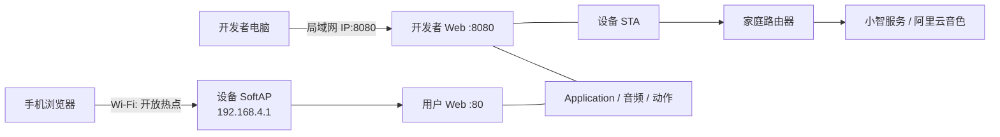
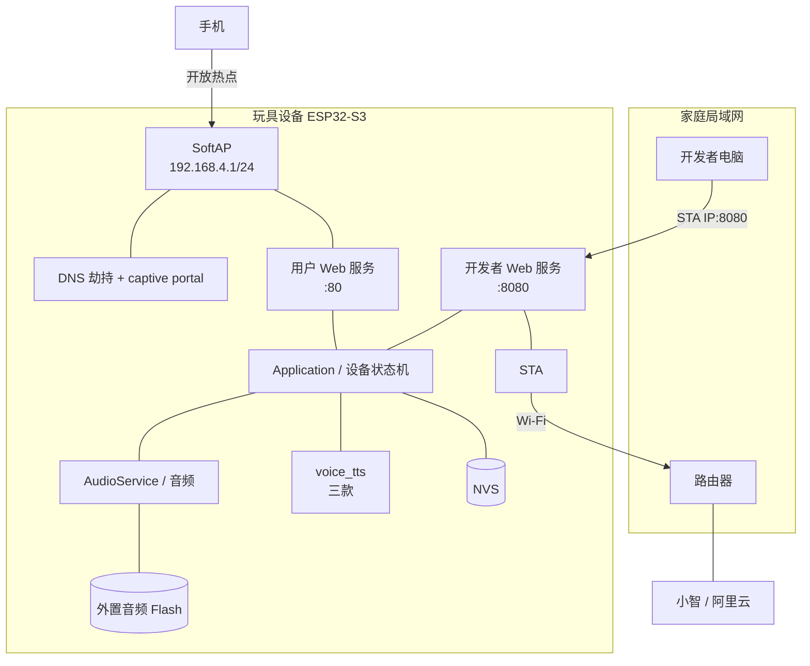
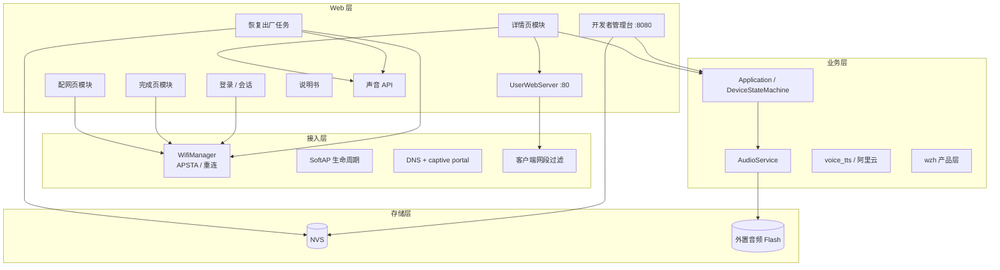
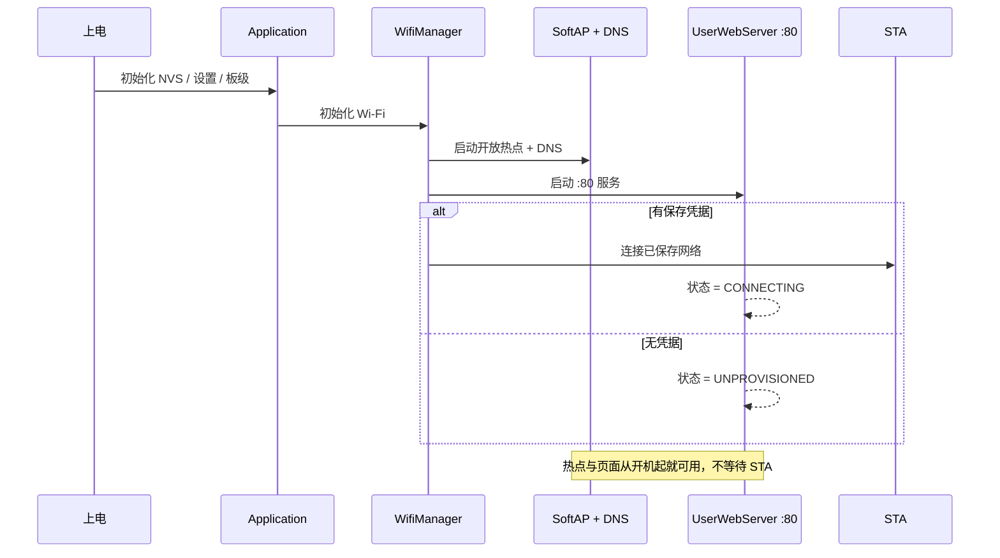
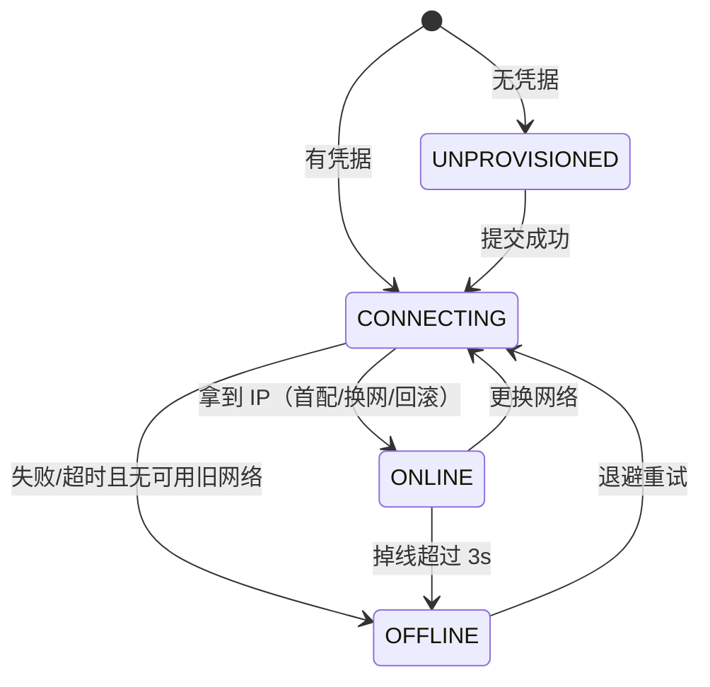
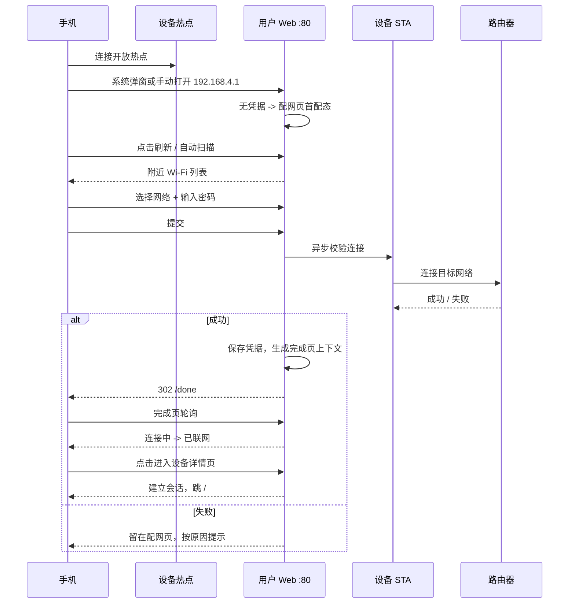
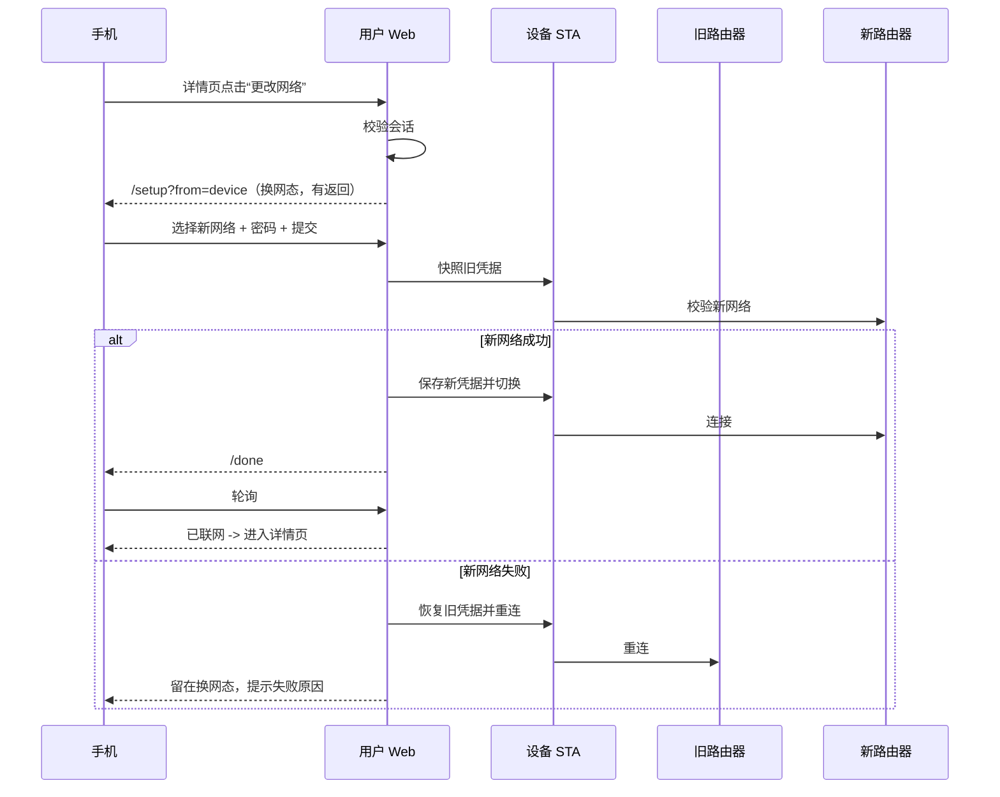
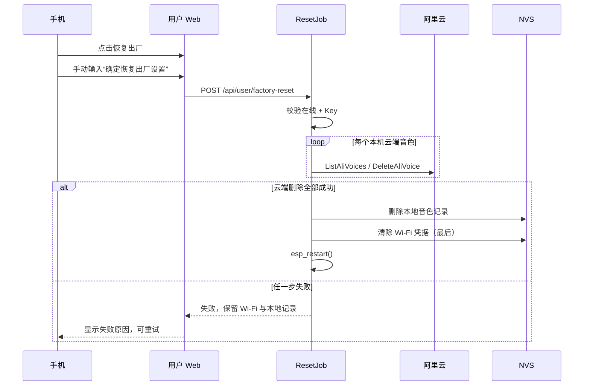

# ZYLZ 设备网页系统：开发目标文档

> 版本：v2.0（目标指引）
> 日期：2026-11-08
> 状态：已实现（主机测试、三款构建与浏览器冒烟通过；真机矩阵待测，见第 17.3 节）。
> 适用产品：wzh_crawlPanda（爬爬熊猫）、wzh_dinosaur（恐龙）、wzh_tailRedPanda（摇尾小熊猫）
> 文档角色：本文档是后续开发的唯一目标指引。实现、测试、评审以本文档为准；需求变化先改本文档，再改代码。

> **2026-11-09 用户需求更新：**大熊猫、小熊猫和恐龙的用户页面都展示声音管理，用户页录音使用手机并上传音频文件；设备麦克风录音保留在聊天/开发者页，两种方式共用音色管理。下文仅大熊猫展示声音区的旧约束不再适用。手机系统录音能力因浏览器而异：iPhone 可在语音备忘录中录制并保存到“文件”后上传；网页直接调用麦克风需要浏览器支持及安全上下文。该更新尚需三款产品与不同手机真机验收。

> **2026-11-12 实现变更（当前）：**用户网页端（:80）与常驻 SoftAP 已移除；配网改由微信小程序通过 BLE 完成。设备只保留 :8080 开发者页，绑定 STA 局域网并拒绝 AP 客户端。下文第 3 节等关于用户页、热点和双端口的目标描述属于历史设计，以本条为准。

**状态标记**

| 标记 | 含义 |
| --- | --- |
| [已确认] | 用户已明确拍板，开发按此执行 |
| [建议] | 当前推荐方案，未最终确认；不影响骨架时可先按建议实现 |
| [待定] | 明确未决定，集中在第 14 节；开发前需确认或采用默认值 |
| [现状] | 当前代码事实，仅用于对照，不代表目标 |
| [目标] | 本次开发要达成的行为 |

---

## 0. 文档定位

### 0.1 一句话目标

把“配网门户 + 开发者管理台”改造成一套完整的设备网页系统：

**手机连上设备热点，就进入当前状态对应的页面；未配网或当前离线看配网页，当前在线看设备详情页；配网成功后完成页停留，可进入详情页；详情页能改网络、控制对话、管理声音、看说明书、恢复出厂；开发者管理台迁到局域网独立端口，只给开发者用。**

### 0.2 目标

1. 用户不需要知道 IP、不需要记端口：连热点后由系统探测或手动打开 192.168.4.1 即可。
2. 首次配网、离线恢复、更换网络三条路径都能在同一个配网页完成，且不会把设备锁死在“没有网络也没有页面”的状态。
3. 配网成功后不再自动退出、不再关热点；完成页给用户明确的下一步。
4. 设备详情页是用户日常入口：状态、音量、对话、声音复刻、说明书、恢复出厂。
5. 开发者能力与用户能力物理分开：用户页面在 :80，开发者页面在局域网 IP:8080。
6. 所有页面与设备运行状态解耦：网页停留不阻塞待机、对话、音频和动作。
7. 三款产品共用页面骨架，只替换品牌与能力开关；三款都提供声音复刻。

### 0.3 非目标

- 不做 HTTPS。设备资源、证书和局域网体验都不适合本期；密码与页面是 HTTP 明文，风险已在第 10 节记录并被用户接受。
- 不做云端账号体系、手机 App、远程控制。
- 不做网页版对话（不传音频、不显示聊天记录）；“进入对话”只等价于双击电源键。
- 不做用户侧 OTA；OTA 只在开发者页。
- 三款声音复刻均按现有设备能力展示；不新增产品线。
- 不改路由器、不做配网以外的网络管理。
- 不重写上游 XiaoZhi 架构；只改 WZH 产品层、门户 fork 和必要的网络/服务底座。

### 0.4 阅读顺序

1. 第 1–2 节：范围、术语、地址。
2. 第 3–4 节：架构、状态、路由；这是开发骨架。
3. 第 5–6 节：流程与页面规格；这是交互验收依据。
4. 第 7 节：接口契约；前后端并行开发的依据。
5. 第 8–9 节：设备端实现要求与数据。
6. 第 10–13 节：风险、兼容、阶段、测试。
7. 第 14 节：未决事项；第 15 节：现有代码事实。

### 0.5 变更规则

- 任何影响路由、鉴权、恢复出厂顺序、页面入口的改动，必须先更新本文档并记录到第 16 节。
- 实现与本文档不一致时，以本文档为评审基准；若本文档本身有误，先改文档。
- 标记 [待定] 的项不得成为阻塞开发的理由；按第 14 节默认值实现，确认后只改策略/文案。

---

## 1. 产品范围与需求追踪

### 1.1 产品矩阵

| 产品 | 板级目录 | 品牌名 | Emoji | 主色 | 声音复刻 | 页面 |
| --- | --- | --- | --- | --- | --- | --- |
| 爬爬熊猫 | main/boards/wzh_crawlPanda | CrawlPanda | 🐼 | #16a34a | 有 | 完整 |
| 恐龙 | main/boards/wzh_dinosaur | Dino | 🦕 | #ea580c | 有 | 完整 |
| 摇尾小熊猫 | main/boards/wzh_tailRedPanda | RedPanda | 🐾 | #e11d48 | 有 | 完整 |

共同点：

- 三款都是 ESP32-S3 + 单 Wi-Fi 射频，AP 与 STA 必须共存。
- 三款共用 build/ 目录，**构建必须串行**，不能并行跑三款。
- 设备热点 SSID = 产品前缀 + “-” + SoftAP MAC 后四位；例如 CrawlPanda-1A2B。
- 页面密码 = “zylz” + 热点名称后四位；例如 zylz1A2B。
- 用户页面只出现在设备热点网段；开发者页面只出现在设备所连的局域网。

### 1.2 用户核心诉求

1. 连上设备热点就能看到正确页面，不需要自己找 IP。
2. 首次配网要简单：看到附近网络、选一个、输密码、连上。
3. 配网成功后不要立刻把热点关掉、不要自动踢掉手机。
4. 完成页要有完成感，并给“进入设备详情页 / 稍后再看”两个选择。
5. 设备详情页要能看状态、调音量、进入对话、管理声音、看说明书、恢复出厂。
6. 更换网络要能回到配网页；换网失败不能把旧网络弄丢。
7. 之前连过但当前连不上，要像没配网一样给出配网页，而不是让用户对着一个进不去的详情页。
8. 详情页要有点隐私：进入前输密码；密码写在说明书上。
9. 恢复出厂要真的像出厂：清网络、清本机云端复刻音色；但不能把绑定、Key、音频库误删。
10. 开发者功能不要出现在用户页面。

### 1.3 需求追踪表

| 编号 | 需求 | 对应章节 | 开发阶段 |
| --- | --- | --- | --- |
| R1 | 连热点自动/手动进入正确页面 | 3、4、5.1 | P1、P2 |
| R2 | 首次配网页（扫描、选择、连接、错误提示） | 5.1、6.2 | P2 |
| R3 | 完成页停留、不自动退出、两个按钮 | 5.3、6.4 | P3 |
| R4 | 完成后进入设备详情页，仅首次免密 | 5.4、6.5、7.2 | P3、P4 |
| R5 | 详情页更改网络，可返回，失败回滚 | 5.6、6.2 | P2、P4 |
| R6 | 当前离线（含掉线）回配网页 | 4.1、4.4、5.5 | P1、P2 |
| R7 | 页面密码与会话 | 6.3、7.2 | P4 |
| R8 | 详情页状态、音量、对话、声音、说明书、恢复出厂 | 6.5–6.6 | P4、P5、P6 |
| R9 | 声音复刻三款均可 | 6.5、8.8 | P5 |
| R10 | 恢复出厂顺序：先删音色，最后清 Wi-Fi | 5.9、8.4、9.3 | P6 |
| R11 | 使用说明书，含密码规则 | 6.6 | P6 |
| R12 | 开发者页迁到局域网 8080，OTA 只在这里 | 6.7 | P7 |
| R13 | 用户页面引导 | 6.1、6.2、6.5 | P2、P3、P6 |
| R14 | 三款产品共用页面、能力开关 | 1.1、8.8 | P8 |

---

## 2. 术语与地址

### 2.1 术语

| 术语 | 定义 |
| --- | --- |
| 设备热点 / SoftAP | 设备自己开的 Wi-Fi，开放网络，IP 192.168.4.1 |
| STA | 设备作为客户端连接家庭路由器的那一端 |
| APSTA | ESP32 同时开热点并连路由器的模式 |
| 在线 | **设备当前 STA 已连上路由器并拿到 IP**；不是“本次开机连上过”，也不是“云端可用” |
| 离线 | 有保存凭据，但当前 STA 未连上；包括从未连上、连接中、连上后掉线 |
| 首配态 | 设备没有保存凭据时的配网页状态，无返回键 |
| 离线配网态 | 有保存凭据但当前离线时的配网页状态，无返回键 |
| 换网态 | 设备在线、从详情页进入配网页时的状态，有返回键 |
| 完成页会话 | 提交配网成功后生成的一次性上下文，用于完成页轮询和免密进入详情页 |
| 页面密码 | “zylz” + 热点名称后四位，由 SoftAP MAC 推导，不落 NVS |
| 用户页面 | 配网页、完成页、登录页、设备详情页、使用说明书 |
| 开发者管理页 | 现有 8080 管理台，迁到局域网 IP 后只给开发者 |
| 恢复出厂任务 | 异步任务：校验 → 删云端音色 → 删本地音色记录 → 清 Wi-Fi → 重启 |

### 2.2 地址与端口

| 页面 / 服务 | 地址 | 端口 | 谁可以访问 |
| --- | --- | --- | --- |
| 设备详情页 | http://192.168.4.1/ | 80 | 设备热点客户端，且已登录 |
| 登录页 | http://192.168.4.1/login | 80 | 设备热点客户端 |
| 配网页 | http://192.168.4.1/setup | 80 | 热点客户端；在线未登录时需先登录 |
| 完成页 | http://192.168.4.1/done | 80 | 持有有效完成页会话的客户端 |
| 使用说明书 | http://192.168.4.1/manual | 80 | 已登录且在线的设备热点客户端 |
| 状态 API | http://192.168.4.1/api/status | 80 | 热点客户端，只读公开 |
| 开发者管理页 | http://设备STA-IP:8080/ | 8080 | 局域网客户端，且非 192.168.4.0/24 |
| 旧完成页兼容 | http://192.168.4.1/done.html | 80 | 302 到 /done |
| 旧退出接口 | http://192.168.4.1/exit | 80 | 不再作为用户动作；保留兼容或返回 410 |

补充：

- 用户页面和开发者页面在同一个固件、同一个设备上，但**客户端来源网段不同**，见 3.3。
- 设备热点 IP 固定 192.168.4.1；STA IP 由路由器分配，不固定，开发者需要自己查。
- captive portal 的系统探测路径统一 302 到 “/”，再由 “/” 按状态分流。

### 2.3 网络平面



---

## 3. 总体架构

### 3.1 物理拓扑



### 3.2 软件分层



### 3.3 端口、网段与隔离

核心约束：esp_http_server 只能按端口绑定 0.0.0.0，**不能按 IP 分别绑定**。所以“用户页面只给热点、开发者页面只给局域网”必须通过客户端来源 IP 过滤实现。

| 服务 | 端口 | 允许来源 | 拒绝来源 | 鉴权 |
| --- | --- | --- | --- | --- |
| 用户 Web | 80 | 192.168.4.0/24（AP 客户端） | 其他网段 | 页面密码 / 会话；配网页在离线态开放 |
| 开发者 Web | 8080 | 非 192.168.4.0/24（局域网） | AP 客户端 | 开发者密码 + token |

实现要点：

- 每个请求用 getpeername 取客户端 IP；用前缀 192.168.4. 判断 AP 网段。
- 过滤在 HTTP 处理入口统一做，不依赖每个 handler 自己判断。
- 开发者页面不提供任何从用户页面跳转的链接；用户页面也不显示 8080 地址。
- 开发调试时如需从 AP 访问 8080，只能临时改代码，不能作为发布行为。

### 3.4 组件职责

| 组件 | 状态 | 职责 | 不负责 |
| --- | --- | --- | --- |
| WifiManager | 改造 | 初始化 Wi-Fi、APSTA 共存、STA 重连、连接状态回调 | 页面、密码、会话 |
| WifiConfigurationAp（esp-wifi-connect fork） | 改造 | AP 生命周期、扫描、凭据校验/保存、DNS、captive portal 探测路径 | 页面路由、用户会话、详情页 |
| UserWebServer | 新增 | 独占 :80；注册路由；模板渲染；静态资源；客户端网段过滤 | 具体业务状态 |
| SetupModule | 新增 | 配网页三态、扫描列表、提交任务、错误映射 | Wi-Fi 驱动细节 |
| DoneModule | 新增 | 完成页、完成页会话、一次性进入 token | 设备详情 |
| AuthModule | 新增 | 页面密码推导、登录、会话 cookie、限速、CSRF | 开发者密码 |
| DetailsModule | 新增 | 详情页 HTML、状态轮询、音量、对话、声音区入口 | 语音云实现 |
| ManualModule | 新增 | 内嵌说明书、按产品生成、离线可用 | 说明书正文最终审定 |
| ResetJob | 新增 | 恢复出厂异步任务、阶段状态、失败中止 | 重启本身 |
| VoiceApi | 新增/包装 | 固定音色、复刻音色、试听、上传、管理 | 阿里云 SDK 细节 |
| DeveloperWebServer | 迁移/改造 | :8080 管理台、OTA、日志、诊断、音频库、Audio Hub | 用户页面 |
| Application / DeviceStateMachine | 少量改动 | 设备运行状态；接收网页触发的对话开关 | 网页会话状态 |
| AudioService | 复用 | 播放、停止、试听、恢复出厂前停声 | 页面 |
| wzh 产品层 | 复用 | 产品配置、Flash、音频库、动作 | 页面 |
| NVS | 复用/新增 key | 凭据、设置、音色记录、重置标记 | 整片擦除 |

### 3.5 关键设计原则

1. **单一 AP 所有者**：只能有一个模块启动/停止 SoftAP。现有配网门户和 8080 管理台各自建 AP 的代码必须合并。
2. **单一 :80 服务器**：esp_http_server 同一端口只能有一个实例。配网页、完成页、详情页、说明书、用户 API 全部注册在同一个 server 上。
3. **状态是算出来的，不是页面设置的**：根路径按“当前网络状态 + 会话”实时分流，不靠“用户打开过哪个页面”。
4. **页面会话与设备状态解耦**：打开配网页不等于设备必须处于 WifiConfiguring；完成页停留也不阻止设备待机/对话。
5. **长任务异步化**：配网提交、云端删除、声音上传都不能在 HTTP handler 里长时间阻塞；返回 202 + 轮询。
6. **页面幂等**：刷新、断线重连、返回，不应产生重复保存、重复删除、重复扣费。
7. **失败安全**：换网失败回滚；恢复出厂失败中止且保留 Wi-Fi；云端删除失败不进入清 Wi-Fi 阶段。
8. **不把秘密写进 HTML**：页面密码不落 NVS、不写页面；完成页 token 一次性、短有效期；开发者密码与会话独立。
9. **不做重框架**：沿用现有原生 HTML/CSS/JS 风格，减少固件体积和浏览器兼容问题。
10. **可测试**：路由、鉴权、重置顺序、IP 过滤要能在 host 侧单测，不依赖真机。

### 3.6 启动时序



---

## 4. 状态模型、路由与决策

### 4.1 网络状态

| 状态 | 条件 | 根路径表现 | 后台行为 |
| --- | --- | --- | --- |
| UNPROVISIONED | 没有任何可用 Wi-Fi 凭据 | 配网页（首配态） | 不重连；等待用户提交 |
| CONNECTING | 有凭据，正在连接/等 DHCP | 配网页（离线态，显示“正在连接”） | 连接尝试，超时后转 OFFLINE |
| ONLINE | STA 已连上并拿到 IP | 登录页或详情页 | 保持连接；掉线后转 OFFLINE |
| OFFLINE | 有凭据，但连接失败/超时/掉线 | 配网页（离线态） | 指数退避重连，永不删凭据 |

补充：

- 在线只代表 Wi-Fi 链路 + IP，不代表小智服务/阿里云可用；详情页会另外显示设备状态与会话状态。
- 掉线判定加 3 秒防抖，避免瞬断导致页面闪烁；超过 3 秒仍未恢复才转 OFFLINE。
- OFFLINE 下继续重连，间隔建议 5s → 10s → 30s → 60s 封顶；不因为离线删除凭据。
- 连接等待窗口沿用 CONFIG_WIFI_CONNECT_TIMEOUT_SEC 默认 60 秒；超时只改变状态，不关 AP。



### 4.2 配网/操作子状态

| 子状态 | 含义 | 页面表现 |
| --- | --- | --- |
| IDLE | 无进行中的配网/切换 | 正常路由 |
| SUBMITTING | 首配或离线配网提交校验中 | 配网页按钮转圈，禁止重复提交 |
| SWITCHING | 在线换网校验中 | 换网态配网页进度；旧连接保持到新连接成功 |
| DONE_WAITING | 已提交成功，等待 STA 在线 | 完成页“正在连接网络” |
| RESET_RUNNING | 恢复出厂任务执行中 | 详情页遮罩进度；写操作拒绝 |

这些子状态不改变设备运行状态，只影响网页行为。

### 4.3 页面与会话状态

| 状态 | 判定 | 可访问 |
| --- | --- | --- |
| 匿名 | 无用户会话 cookie | 配网页（离线/首配）、登录页、公开状态 API |
| 用户会话 | 有效 wzh_sess cookie | 详情页、换网态配网页、说明书、用户写 API |
| 完成页上下文 | 有效 ctx（一次性） | 完成页；可换取用户会话 |
| 开发者会话 | 有效开发者 token | 8080 管理台 |

### 4.4 根路径路由规则

| 当前状态 | 请求 / | 说明 |
| --- | --- | --- |
| UNPROVISIONED | 302 /setup?mode=first | 首配态，无返回 |
| CONNECTING | 302 /setup?mode=offline&connecting=1 | 显示“正在连接已保存网络” |
| OFFLINE | 302 /setup?mode=offline | 离线态，无返回 |
| ONLINE + 有效用户会话 | 200 详情页 | 正常入口 |
| ONLINE + 无会话 | 302 /login?next=/ | 先输密码 |
| ONLINE + 完成页上下文换来的会话 | 200 详情页 | 仅完成页按钮触发 |

补充规则：

- /login：仅 ONLINE 可访问；UNPROVISIONED/CONNECTING/OFFLINE 一律 302 /setup。
- /setup：UNPROVISIONED/CONNECTING/OFFLINE 直接开放；ONLINE 时必须已有用户会话，否则 302 /login?next=/setup。
- /setup?from=device：在线换网态；必须有用户会话，且带返回键。
- /done：必须带有效完成页上下文；否则 302 /。
- /manual：必须 ONLINE 且有用户会话；否则 302 /login?next=/manual（离线时回 /setup）。
- /api/status：公开只读；其他写 API 按第 7 节鉴权矩阵。
- 刷新 /done：上下文有效则留在完成页；无效则回 /。
- 设备重启后所有会话和完成页上下文失效，按启动状态重新路由。

### 4.5 根路由伪代码

```text
handle_root(req):
  if net_state == UNPROVISIONED:
      return redirect("/setup?mode=first")
  if net_state == CONNECTING:
      return redirect("/setup?mode=offline&connecting=1")
  if net_state == OFFLINE:
      return redirect("/setup?mode=offline")
  // ONLINE
  if valid_user_session(req):
      return details_page()
  return redirect("/login?next=/")

handle_setup(req):
  if net_state == ONLINE:
      if not valid_user_session(req):
          return redirect("/login?next=/setup")
      return setup_page(mode="switch")
  if net_state == UNPROVISIONED:
      return setup_page(mode="first")
  return setup_page(mode="offline")
```

### 4.6 在线判据与掉线

- 在线判据：STA 已连接 + 已拿到 IP。以 WifiManager 的状态回调为准。
- 不使用“本次开机是否连上过”作为判据；这是本版最重要的修正。
- 详情页每 2 秒轮询 /api/status；连续 3 秒检测不到在线，显示“网络已断开，正在返回配网页”，随后 location 到 /setup。
- 如果 3 秒内恢复，取消跳转。
- 页面切到后台时暂停轮询；回到前台立即刷新一次。
- 掉线后后台继续重连；重连成功不强制跳走用户正在看的配网页，最多 toast 提示“网络已恢复”。

### 4.7 网页状态与设备状态解耦

- 网页会话只存在于 Web 任务；不写 kDeviceStateWifiConfiguring。
- 配网模式可以影响设备是否联网，但“有人打开网页”本身不改变设备状态。
- 完成页停留时，设备可以正常待机、对话、播放；不因为页面还在 /done 就阻止。
- 网页触发的对话开关必须走 Application::SetDeviceState() 和现有状态机，不允许直接改字段。
- 网页触发的音频试听要走 AudioService 的播放门控；设备忙时返回 409，不排队堆积。

### 4.8 已确认决策台账

| 编号 | 决策 | 结论 | 出处 |
| --- | --- | --- | --- |
| D1 | 常驻热点安全模式 | 保持开放热点；详情页以只读/轻操作为主，危险操作在开发者页 | 第 4.4、10 节 |
| D2 | 开发者管理页地址 | 局域网 IP + 8080；拒绝 AP 网段访问 | 3.3、6.7 |
| D3 | 完成页“稍后” | 只停留提示，不关热点、不自动关闭 | 5.3、6.4 |
| D4 | 换网行为 | 保持旧 STA 到新网络验证成功；失败回滚 | 5.6 |
| D5 | 热点生命周期 | 常开，设备运行期间随时可连 | 3.6、4.1 |
| D6 | 首配页面返回键 | 无 | 6.2 |
| D7 | 页面密码 | zylz + 热点名称后四位；仅完成页跳转免密；进入后改网/删音色不再验证 | 6.3、7.2 |
| D8 | 语言/品牌 | 后续页面设计时定；当前中文优先，品牌 token 已存在 | 6.8 |
| D9 | 网络不可达 | 当前离线（含曾连上后掉线）即回配网页；凭据保留并后台重试 | 4.1、5.5 |
| D10 | 进入对话 | 与双击电源键相同，只启动对话，不做网页对话 | 5.8、6.5 |
| D11 | OTA 入口 | 只放开发者页；用户页面只显示版本号 | 6.7 |
| D12 | 固定音色试听 | 设备扬声器播放（设备空闲时） | 6.5 |
| D13 | 详情页字段 | 温度直接写“温度”；显示充电状态与运行时长；不显示音频 Flash 占用 | 6.5 |
| D14 | 阿里 Key | 量产预置到设备，用户无感；开发者页保留配置能力 | 8.8、9.1 |
| D15 | 页面指导 | 用户页面均可加简短引导 | 6.1 |
| D16 | 恢复出厂 | 手动输入“确定恢复出厂设置”；先删云端/本地音色，最后清 Wi-Fi；保留密码/绑定/Key/音频库/其他设置；失败中止；重启进配网 | 5.9、8.4、9.3 |
| D17 | 使用说明书 | 详情页独立按钮打开完整说明 | 6.6 |
| D18 | 初始密码 | 固定 zylz + 设备热点名称后四位，写入说明书 | 6.3、6.6 |

---

## 5. 用户流程

### 5.1 首次配网

**前置**：设备无保存凭据，网络状态 UNPROVISIONED。



步骤：

1. 上电即开开放热点、DNS 劫持和 :80 服务；不等 STA。
2. 手机连热点；iOS/Android 可能弹“需要登录网络”，不保证；页面始终可手动访问 192.168.4.1。
3. 根路径 302 到 /setup?mode=first；页面显示品牌、引导气泡、Wi-Fi 列表。
4. 用户刷新/等待扫描；列表显示 SSID、信号、加密、已保存标记；不显示 5GHz 提示以外的复杂信息。
5. 选择网络，输入密码；开放网络直接连接；隐藏网络可手动输入 SSID。
6. 提交后按钮进入进度态，禁止重复提交；服务端异步校验，页面轮询。
7. 成功：保存凭据（只在新网络验证成功后覆盖当前网络），生成完成页上下文，302 /done。
8. 失败：不保存；按密码错误/找不到/超时/路由器拒绝分别提示；用户可重试或改选。
9. 配网页不显示 OTA、休眠、发射功率等高级项。

异常：

- 手机不支持 captive portal：手动地址始终可用。
- 5GHz 网络：ESP32-S3 扫描不到；页面提示“仅支持 2.4GHz”。
- 密码错误：不泄露“密码是否正确”以外的信息；提示重试。
- 热点通道随 STA 切换导致手机短暂掉线：页面轮询可恢复；见 10.1。

### 5.2 配网提交（服务端语义）

- 提交必须异步：HTTP 返回 202 + job id/上下文，页面轮询；避免 10–60 秒连接校验把 HTTP 超时。
- 校验使用现有 WifiManager 连接能力；只在校验成功后保存凭据。
- 首配/离线配网：成功后当前网络替换为新网络；旧凭据在新网络成功前不删除（离线时没有可用旧连接，但仍保留到成功）。
- 换网态：先快照旧 SSID/密码；新网络验证成功后保存并切换；失败恢复旧凭据并重连，页面回到换网态提示。
- 提交成功后网络状态进入 CONNECTING；STA 拿到 IP 后 ONLINE。
- 提交期间禁止再次提交；允许返回/关闭页面，后台继续。

### 5.3 完成页

**前置**：提交成功；持有完成页上下文。

状态：

| 状态 | 触发 | 页面 |
| --- | --- | --- |
| CONNECTING | 已保存，等待 IP | 动画播放中；状态“正在连接网络”；按钮禁用 |
| ONLINE | STA 拿到 IP | 完成动画；显示“已联网”；主按钮启用 |
| FAILED | 连接失败 | 显示原因；“重试 / 返回修改” |
| EXPIRED | 上下文过期/设备重启 | 302 /，提示重新连接 |

规则：

- 取消现有“1 秒后自动 POST /exit”。
- 不再关闭热点、不退出配网模式、不踢手机。
- 完成动画 1–2 秒；尊重系统“减少动效”。
- 动画结束后出现两个按钮：主“进入设备详情页”，次“稍后”。
- 主按钮在 ONLINE 后才启用；未在线显示“正在连接网络”，不可点。
- 主按钮：POST /api/enter（带完成页上下文）→ 服务端校验 → 建立用户会话 → 302 /。
- 完成页上下文一次性、10 分钟有效、绑定客户端 IP；不能重放。
- 次按钮：停留本页，提示“可以直接关闭页面，设备会继续运行”；不设自动关闭。
- 刷新：上下文有效则留在完成页；无效则回 /。
- 用户关闭页面后再连热点：在线则登录页（不是详情页）；离线则配网页。

### 5.4 已在线设备连接热点

1. 手机连设备热点。
2. 根路径 / → 无会话则 /login?next=/。
3. 输入页面密码（zylz + 热点后四位）。
4. 会话建立 → 详情页。
5. 已有有效会话 → 直接详情页。
6. 开发者页不在此流程出现。

### 5.5 当前离线设备连接热点

1. 设备有凭据但当前 STA 未连上（从未连上、正在连、掉线）。
2. 根路径 / → /setup?mode=offline；无返回键。
3. 页面提示“已保存的网络暂时连不上，可以重新选择或稍后重试”；已保存网络标“暂时不可用”。
4. 用户可刷新、改选网络、提交；旧凭据在新网络成功前保留。
5. 后台继续重连；如果用户没操作而网络恢复，下次刷新 / → 登录页/详情页。
6. 已打开的配网页不强制跳走，可 toast “网络已恢复”。

### 5.6 更改网络

**前置**：在线 + 已登录详情页。



规则：

- 返回键：回详情页，不改任何配置。
- 换网期间保持 AP；旧 STA 尽量保持到新网络验证成功；射频只有一套，校验时可能短暂断开旧 STA，页面要能恢复。
- 新网络失败：恢复旧凭据并重连；页面提示失败原因；旧网络恢复后详情页仍可用。
- 换网成功：完成页；已有会话，主按钮直接回详情页，不再要求密码。
- 换网态如果中途掉线：页面进入离线态（无返回），按 5.5 处理；旧凭据仍保留。

### 5.7 稍后 / 直接关闭

- 点“稍后”或关闭浏览器：设备不退出任何服务；AP、DNS、:80 继续运行。
- 完成页上下文最多保留 10 分钟；过期后从 /done 回 /。
- 之后连热点：在线 → 登录页；离线 → 配网页。
- 不因为用户离开而关闭热点或重启。

### 5.8 进入对话

- 详情页按钮“进入对话”与双击电源键同效，只启动/结束对话。
- 不打开网页聊天、不传音频、不显示对话内容。
- 设备忙（连接中/升级中/配网中）时按钮禁用；服务端返回 409 时页面 toast。
- 按钮文案随设备状态变化：进入对话 / 结束对话 / 设备忙。
- 网页只调用现有对话开关能力，不直接改设备状态字段。

### 5.9 恢复出厂

**前置**：在线 + 已登录详情页；爬爬熊猫还需阿里 Key。



交互：

- 详情页底部按钮；点击后弹出对话框，必须手动输入短语“确定恢复出厂设置”（去首尾空格，精确匹配），不要求页面密码。
- 提示文案：“将先删除本机云端复刻音色，再清除网络；设备会重启并重新配网。”
- 执行中显示阶段进度；禁止重复提交；其他写 API 返回 503。
- 成功后设备重启，手机掉线；页面提示“设备正在重启，请重新连接设备热点”。

执行顺序（不可调换）：

1. 校验在线、阿里 Key、无其他重置任务。
2. 枚举本机专属云端复刻音色（按 MAC 前缀），逐个删除；404/已不存在视为成功；网络错误/鉴权失败中止。
3. 删除本地音色记录（当前/上一个/名称列表）；失败中止。
4. 最后清除 Wi-Fi 凭据（所有已保存网络）。
5. esp_restart()。

失败处理：

- 云端删除部分成功：从本地列表移除已删项；当前/上一个失效则回退内置音色；中止，保留 Wi-Fi；提示重试。
- 本地记录删除失败：中止，保留 Wi-Fi；云端已删的项同样从列表清理。
- Wi-Fi 清除失败：中止；此时云端/本地已清，可重试清除 Wi-Fi。
- 掉线：中止；不继续清 Wi-Fi。

### 5.10 使用说明书

- 入口只在详情页底部；不在配网页、完成页、登录页放链接。
- /manual 需要 ONLINE + 用户会话；离线时已加载的静态页面仍可读，但刷新/重新进入会回配网页。
- 内容含：产品介绍、部件、充电/开关机、按键/触摸、对话、灯效、配网/换网、声音、动作、保护、常见问题、恢复出厂、规格、安全、页面密码规则。
- 中文优先；英文预留；按产品生成；纯文本 + 少量内联样式，控制体积。

### 5.11 开发者管理页

- 地址：http://设备STA-IP:8080/；只允许局域网客户端；AP 网段拒绝。
- 登录：现有开发者密码 + token；建议保留 30 分钟过期；增加失败限速。
- 内容：现有管理台整体迁移；OTA 从配网页迁入；新增日志、网络诊断、系统信息、动作调试等。
- 用户页面不出现任何开发者入口或提示。
- 设备离线时 8080 不可达；这是 D2 的代价，用串口日志兜底。

### 5.12 场景总表

| 场景 | 前置 | 根路径 | 用户动作 | 结果 |
| --- | --- | --- | --- | --- |
| 首次开机 | 无凭据 | 配网页首配态 | 选网、输密码、提交 | 完成页 → 详情页 |
| 配网失败 | 首配态 | 配网页 | 重试/改选 | 不保存，留在配网页 |
| 配网成功但手机掉线 | 提交成功 | /done 不可达 | 重连热点 | 在线→登录；离线→配网页 |
| 已在线连热点 | 在线 | 登录页/详情页 | 输密码或直接进 | 详情页 |
| 已配网离线 | 有凭据、离线 | 配网页离线态 | 改选网络/等待 | 成功→完成页 |
| 在线换网 | 在线+会话 | /setup?from=device | 提交新网络 | 成功→完成页；失败回滚 |
| 详情页掉线 | 详情页已打开 | 页面轮询 | 等待/重连 | 3 秒后回配网页 |
| 进入对话 | 详情页 | 详情页 | 点按钮 | 等价双击电源键 |
| 恢复出厂 | 在线+会话 | 详情页 | 输入短语 | 删音色→清 Wi-Fi→重启 |
| 恢复出厂失败 | 执行中 | 详情页遮罩 | 重试 | 保留 Wi-Fi，可重试 |
| 看说明书 | 在线+会话 | 详情页 | 点按钮 | /manual |
| 开发者访问 | 同一局域网 | 8080 | 登录 | 管理台 |

---

## 6. 页面规格

### 6.1 通用规范

- 移动优先：360–430 px 宽度；触控目标 ≥ 44 px；单列布局。
- 品牌：使用 esp-wifi-connect fork 的 WZH_* token（名称、emoji、主色、深浅色）；新页面复用同一套 CSS 变量。
- 语言：中文优先；英文预留；文案集中管理，不在 JS 里散落硬编码。
- 框架：原生 HTML/CSS/JS；不引入 React/Vue；页面总大小控制在几十 KB。
- 轮询：只在页面可见时进行；visibilitychange 暂停/恢复；断线退避。
- 缓存：HTML 与 API 响应 Cache-Control: no-store；静态资源可内嵌。
- 动效：1–2 秒内；尊重 prefers-reduced-motion。
- 可访问性：label、焦点可见、对比度、错误用文字不只颜色。
- 错误：统一“人话 + 错误码”；不要只显示“失败”。
- 引导：可关闭、不阻塞；首次引导与页面内问号结合。
- 安全：用户页面不出现开发者入口；不在 HTML 里写密码/Key；写操作防重复。

### 6.2 配网页 /setup

三种模式：

| 模式 | 触发 | 返回键 | 顶部提示 | 提交后 |
| --- | --- | --- | --- | --- |
| first | 无凭据 | 无 | 首次配网引导 | 完成页 |
| offline | 有凭据但离线 | 无 | 已保存网络暂时不可用 | 完成页 |
| switch | 在线 + 会话 + from=device | 有 | 换网不会删除当前网络 | 完成页/失败留在本页 |

布局示意：

```text
┌────────────────────────────┐
│ 🐼 CrawlPanda              │
│ 连接设备热点                │
│ ┌────────────────────────┐ │
│ │ 引导气泡：1/3 ... 跳过  │ │
│ └────────────────────────┘ │
│ Wi-Fi 列表                  │
│  ▂▄▆ Home_2.4G       🔒    │
│  ▂▄  Guest           🔒    │
│  ▂   Office          🔒    │
│ [刷新]  [手动输入网络]      │
│                            │
│ （换网态）[返回]            │
└────────────────────────────┘
```

要素与行为：

1. 顶部：品牌 emoji + 名称 + 当前模式标题。
2. 引导气泡：首配 3 步（连热点 → 选网络 → 输密码）；仅首次出现；可跳过；NVS 记录是否看过（重置后是否重看见第 14 节）。
3. 离线提示：仅在 offline 模式显示；列出已保存网络并标“暂时不可用”；说明后台仍在重试。
4. 换网提示：switch 模式显示“更换网络不会删除当前网络，新网络连接成功后才切换”。
5. Wi-Fi 列表：SSID、信号强度、加密锁、已保存/当前标记；按信号排序；隐藏 SSID 不显示；扫描中骨架屏。
6. 刷新：点击重新扫描；扫描期间禁用；建议 5 秒冷却。
7. 手动输入网络：弹出 SSID + 密码；用于隐藏网络。
8. 密码输入：显示/隐藏；WPA2/WPA3；开放网络确认；不把密码写日志。
9. 提交：按钮进度；禁止重复；成功跳完成页；失败按原因提示。
10. 换网态返回：回详情页，不修改配置。
11. 首配/离线态不显示返回；避免用户回到一个不存在的详情页。
12. 不显示 OTA、休眠、发射功率、开发者入口。
13. 2.4GHz 提示：列表顶部或空态提示“设备仅支持 2.4GHz Wi-Fi”。

错误文案：

| 情况 | 文案建议 |
| --- | --- |
| 密码错误 | 密码不正确，请重新输入 |
| 找不到网络 | 没有找到这个网络，请靠近路由器或刷新 |
| 连接超时 | 连接超时，请确认路由器已开启 2.4GHz |
| 路由器拒绝 | 路由器拒绝了连接，请检查黑名单/连接数 |
| 5GHz | 该网络可能是 5GHz，设备仅支持 2.4GHz |
| 提交冲突 | 正在处理上一次请求，请稍候 |
| 会话过期 | 登录已过期，请重新输入页面密码 |

验收：

- 首配、离线、换网三态都可达；返回键只在换网态出现。
- 扫描列表可刷新、可选、可输密码、可提交；失败不保存旧配置。
- 换网失败旧网络恢复，详情页仍可进。
- 页面无 OTA/开发者入口。

### 6.3 登录页 /login

- 仅在线可访问；离线/未配网 302 /setup。
- 内容：品牌、标题“输入页面密码”、密码输入、显示/隐藏、提交。
- 密码规则不提示（用户确认：写在说明书；不购买产品的人不应知道）。
- 错误：密码错误；连续 5 次失败限速 60 秒，返回 429 + 剩余秒数。
- 成功：建立会话，302 next（默认 /）。
- 已有会话：302 /。
- 不做“忘记密码”；说明书里有规则。

### 6.4 完成页 /done

- 仅持有完成页上下文可访问；否则 302 /。
- 状态：CONNECTING / ONLINE / FAILED / EXPIRED。
- 动画：1–2 秒完成动画；连接中可有循环动画；减少动效时静态。
- 文案：
  - 连接中：正在连接网络…
  - 成功：网络连接成功
  - 失败：连接失败 + 原因 + “返回修改”
  - 超时：网络较慢，可返回修改或稍后重试
- 按钮：
  - 主：进入设备详情页；仅 ONLINE 启用；点击 POST /api/enter。
  - 次：稍后再看；停留，提示可关闭页面。
- 不自动 POST /exit；不自动关闭热点；不自动跳详情。
- 刷新：上下文有效留在本页；无效回 /。
- 手机如果在 STA 通道切换时掉线：页面提示“如果页面断开，请重新连接设备热点并打开 192.168.4.1”。

### 6.5 设备详情页 /

布局示意：

```text
┌────────────────────────────┐
│ 🐼 CrawlPanda       ● 在线  │
│ [进入对话]                  │
│ ┌──────────┐ ┌──────────┐  │
│ │ 电量 86% │ │ 温度 41°C │  │
│ │ 充电中   │ │          │  │
│ └──────────┘ └──────────┘  │
│ Wi-Fi Home_2.4G  ▂▄▆  IP   │
│ [更改网络]                  │
│ 版本 1.0.0 · 运行 2h 13m    │
│ 设备状态：待机               │
│ 音量 ─────────●──── 60      │
│ 声音                        │
│ 固定音色 [龙安欢][龙安灵心]… │
│ 复刻音色 [创建][管理]        │
│ [使用说明书] [恢复出厂设置]  │
└────────────────────────────┘
```

区块：

| 区块 | 内容 | 数据 | 交互 |
| --- | --- | --- | --- |
| 顶部 | 产品名/emoji、在线状态、进入对话 | /api/status + 设备状态 | 对话开关 |
| 状态卡 | 电量 % + 充电、温度、网络 SSID/RSSI/IP、版本/构建/运行时长、设备状态 | /api/status | 更改网络 |
| 音量 | 0–100 滑条 | 设置 | 松手保存 |
| 声音 | 固定音色 6 个；复刻音色创建/管理 | 声音 API | 选择、试听、创建、重命名、删除 |
| 底部 | 使用说明书、恢复出厂 | 静态/任务 API | 打开/确认 |

字段规则：

- 温度：直接写“温度”，来源 Board::GetTemperature（芯片温度）；引导里说明“芯片温度，供参考”。
- 电量：百分比 + 充电状态；低电量按现有保护逻辑提示（不在网页做保护）。
- 网络：当前 SSID、信号、IP；在线才显示；离线页面会跳走。
- 版本：固件版本 + 构建名 + 运行时长。
- 不显示音频 Flash 占用（D13）。
- 设备状态：待机/连接中/对话中/播放中/升级中/配网中；不要直接暴露原始枚举。
- 设备名：显示产品配置名；本期不做重命名。
- 刷新：2 秒轮询；页面隐藏暂停；401 跳登录；离线 3 秒跳配网。

音量：

- 拖动即时显示数值；松手保存（或 200ms 防抖）。
- 0–100；服务端 clamp；保存到 settings。
- 设备忙时允许调音量？允许，音量不影响对话状态；但写 NVS 要避免频繁。
- 失败回滚到上次值并提示。

进入对话：

- 与双击电源键同效；不打开网页聊天。
- 按钮状态随 /api/status 的 state 变化；忙时禁用。
- 409 时 toast“设备正在忙”。

声音区（三款）：

- 分区顺序固定为：固定音色标签 → 复刻音色（创建/选择/试听）→ 复刻音色管理（列表/重命名/删除/切换）。
- 固定音色：6 个内置音色（龙安欢、龙安灵心、龙安风悦、许南川、于小云、温怀清）；标签展示名称 + 风格；当前高亮；点击选中；试听按钮用设备扬声器。
- 复刻音色：
  - 创建：手机录音/上传，5–20 秒、16kHz、16-bit、单声道；名称 ≤48 字节；生成中显示进度；一次只允许一个任务。
  - 列表：名称、状态、当前/上一个标记；选择、试听、重命名、删除。
  - 删除：二次确认，说明“会同时删除阿里云端的专属音色，不可恢复”；删除当前音色先切回内置/上一个。
  - 上限 10 个；达到上限提示先删除。
  - 未配置阿里 Key：整个声音区显示“语音服务未配置，请到开发者页设置”；量产机不出现。
- 试听：设备空闲时才可播放；设备忙返回 409；不排队。

使用说明书与恢复出厂：

- 说明书按钮：打开 /manual。
- 恢复出厂按钮：危险色；点击弹对话框；必须输入“确定恢复出厂设置”；执行中显示阶段；失败显示原因。
- 恢复出厂后设备重启，页面断开；提示重新连热点配网。

页面引导：

- 电量、温度、网络、状态、声音旁加问号或一行小字。
- 首次进入可展示一次引导（浏览器 localStorage）；不写设备。
- 引导可关闭，不遮挡主按钮。

验收：

- 在线且登录才可进；离线 3 秒内回配网页。
- 状态字段正确；音量保存；对话等价双击。
- 三款声音区完整。
- 说明书/恢复出厂入口只在底部；恢复出厂需短语。

### 6.6 使用说明书 /manual

- 形式：内嵌静态 HTML，离线可用；按产品生成；中文优先，英文预留。
- 入口：详情页底部；不在配网页/完成页/登录页。
- 鉴权：需要用户会话；避免未登录直接访问。
- 体积：纯文本 + 少量内联样式，目标几十 KB；不放大图。
- 目录：
  1. 产品介绍与部件
  2. 充电、开关机、指示灯
  3. 按键/触摸操作（单击/双击/长按）
  4. 对话与打断
  5. 配网与更换网络
  6. 页面密码规则（zylz + 热点后四位）
  7. 声音：固定音色、复刻音色、删除影响
  8. 动作与情绪
  9. 保护机制（欠压/高温/舵机）
  10. 常见问题（连不上、5GHz、页面打不开、密码错误）
  11. 恢复出厂
  12. 规格参数
  13. 安全与保修
- 用户后续完善正文；开发先提供骨架与真实参数占位。

### 6.7 开发者管理页 :8080

迁移原则：现有内容整体搬过去，先保功能，再谈重构；不在用户页面留入口。

现有内容迁移清单：

| 区块 | 现有能力 | 迁移后 |
| --- | --- | --- |
| 设备状态 | 产品/构建/版本/运行时长、会话/麦克风/扬声器/舵机、触摸、电量/电压、Wi-Fi、温度、Flash、音频占用、热点信息 | 状态 Tab |
| 音频库 | 筛选、搜索、试听、停止、刷新 | 音频库 Tab |
| Audio Hub | 连接检查、差异、更新 | 音频库/Audio Hub Tab |
| 开发者模式 | 音量、声音与动作联动、诊断导出、播放缓冲、外置 Flash 擦除 | 系统/调试 Tab |
| 声音复刻 | 当前/上一个、试听、管理、手机录音/文件上传/设备麦克风创建、阿里 Key | 声音 Tab |
| 本地接口文档 | 现有接口说明 | 接口 Tab |
| OTA | 配网页 show_ota_config | OTA Tab（用户页面移除） |

建议新增（按价值）：

1. 实时日志（SSE/WebSocket）与导出。
2. 网络诊断：RSSI、网关、DNS、ping、重连、AP 控制。
3. OTA：上传固件、版本检查。
4. 系统信息：heap/CPU/任务/分区/NVS 浏览。
5. 动作与音效调试台。
6. 电池校准、温度阈值只读。
7. 重启/恢复出厂（二次确认）。
8. MCP 工具调用台（联调需要时）。

访问控制：

- 仅非 AP 网段；AP 客户端 403。
- 开发者密码 + token；保留现有 30 分钟过期；失败限速。
- 不把开发者地址写进用户页面/说明书。
- 默认密码“1”是现有行为；量产是否强制修改另议（第 14 节）。

### 6.8 品牌与文案

| 产品 | 页面标题 | Emoji | 主色 | 热点前缀 |
| --- | --- | --- | --- | --- |
| 爬爬熊猫 | ZYLZ · CrawlPanda 设备配网 | 🐼 | #16a34a | CrawlPanda |
| 恐龙 | ZYLZ · Dino 设备配网 | 🦕 | #ea580c | Dino |
| 摇尾小熊猫 | ZYLZ · RedPanda 设备配网 | 🐾 | #e11d48 | RedPanda |

- 文案语气：短句、友好、可操作；不出现“SSID/STA/DHCP”等术语给用户。
- 错误文案必须告诉用户下一步做什么。
- 中文优先；英文预留；同一文案只维护一份。
- 密码示例：热点 CrawlPanda-1A2B → 密码 zylz1A2B。

---

## 7. 接口设计

> 说明：路径名可在实现时微调，但“职责 + 鉴权 + 状态条件”矩阵不变；变更必须更新本文档与测试。

### 7.1 通用约定

- 编码：UTF-8；请求/响应 JSON，上传接口除外。
- 响应：
  - 成功：HTTP 200/202/204 + JSON。
  - 失败：HTTP 4xx/5xx + { "ok": false, "error": { "code": "...", "message": "..." } }
- 所有 HTML/API：Cache-Control: no-store。
- 写操作：POST；禁止 GET 产生副作用。
- 幂等：重置/上传/删除要能安全重试；重复请求返回当前任务或 409。
- 超时：普通 API 5 秒；上传/重置用异步任务，页面轮询。
- 鉴权失败：401；权限/状态不允许：403/409；限速：429 + Retry-After。
- 错误码建议：AUTH_REQUIRED、AUTH_BAD_PASSWORD、AUTH_RATE_LIMITED、NET_OFFLINE、SETUP_BUSY、SETUP_BAD_PASSWORD、SETUP_NOT_FOUND、SETUP_TIMEOUT、VOICE_NO_KEY、VOICE_LIMIT、VOICE_BUSY、VOICE_TOO_SHORT、VOICE_TOO_LONG、VOICE_DELETE_FAILED、RESET_NOT_ALLOWED、RESET_BUSY、RESET_CLOUD_FAILED、RESET_LOCAL_FAILED、RESET_WIFI_FAILED。

### 7.2 密码、会话、完成页 token

页面密码：

- password = "zylz" + SSID 最后 4 个字符。
- SSID 来自 SoftAP MAC 后四位；大小写按实际 SSID，密码大小写敏感。
- 不存储密码；每次登录现算。
- 比较使用固定时间比较，避免明显时序差异。

登录：

- POST /api/login { "password": "..." }
- 成功：Set-Cookie wzh_sess=<random>; HttpOnly; SameSite=Strict; Path=/；JSON { ok: true, redirect: "/" }
- 失败：401；连续 5 次失败 → 429 60 秒。
- 会话：RAM 保存 token → { expiry, client_ip }；30–60 分钟（默认 30）；设备重启失效；最多同时 4 个，淘汰最旧。
- 登出：POST /api/logout。

完成页 token：

- 提交成功后生成 ctx：随机 128-bit；RAM；绑定客户端 IP；10 分钟；一次性。
- 完成页 HTML 不直接暴露密码；ctx 可出现在页面内 JS 变量或 data 属性。
- POST /api/enter { "ctx": "..." }：校验 ctx + 客户端 IP + ONLINE → 建立用户会话 → { ok: true, redirect: "/" }；ctx 立即失效。
- ctx 过期/重放：401；页面提示重新连接热点。
- 不把 ctx 放进 URL query，避免历史记录/Referer 泄露。

CSRF：

- SameSite=Strict。
- 写请求校验 Origin/Host 为 http://192.168.4.1；不匹配 403。
- 不提供 CORS；浏览器同源即可。

开发者会话：

- 独立 password/token；不与用户 cookie 混用。
- 8080 的 cookie Path=/；名称 dev_sess；30 分钟。

### 7.3 路由与鉴权总表

| 方法 | 路径 | 鉴权 | 允许状态 | 用途 |
| --- | --- | --- | --- | --- |
| GET | / | 无 | 全部 | 状态路由 |
| GET | /login | 无 | ONLINE | 登录页 |
| POST | /api/login | 无 | ONLINE | 登录 |
| POST | /api/logout | 用户 | 任意 | 登出 |
| GET | /setup | 条件 | 全部 | 配网页；ONLINE 需会话 |
| GET | /scan | 条件 | 首配/离线开放；在线需会话 | Wi-Fi 扫描 |
| POST | /submit | 条件 | 首配/离线开放；在线需会话 | 提交配网 |
| GET | /api/setup/status | 上下文/会话 | 提交后 | 轮询进度 |
| GET | /done | 完成页 ctx | 提交后 | 完成页 |
| POST | /api/enter | 完成页 ctx | ONLINE | 换取会话 |
| GET | /manual | 用户 | ONLINE + 会话 | 说明书 |
| GET | /api/status | 无 | 全部 | 公开只读状态 |
| POST | /api/user/volume | 用户 | ONLINE | 设置音量 |
| POST | /api/user/chat/toggle | 用户 | ONLINE | 对话开关 |
| GET | /api/user/voices | 用户 | ONLINE + WZH | 音色列表 |
| POST | /api/user/voices/select | 用户 | ONLINE + WZH | 选择音色 |
| POST | /api/user/voices/audition | 用户 | ONLINE + WZH | 试听 |
| POST | /api/user/voices/clone | 用户 | ONLINE + WZH | 创建复刻 |
| POST | /api/user/voices/rename | 用户 | ONLINE + WZH | 重命名 |
| POST | /api/user/voices/delete | 用户 | ONLINE + WZH | 删除 |
| POST | /api/user/factory-reset | 用户 | ONLINE | 启动恢复出厂 |
| GET | /api/user/factory-reset/status | 用户 | ONLINE | 重置进度 |
| GET | /done.html | 无 | 全部 | 302 /done |
| POST | /exit | 无 | 全部 | 不再使用；410 或 no-op |
| GET | /api/developer/* | 开发者 | 8080 局域网 | 现有开发者 API |
| GET | /api/developer/ota/* | 开发者 | 8080 局域网 | OTA |

说明：

- /scan、/submit 在首配/离线态开放是必要的：用户还没有会话，但必须能配网。
- 在线态 /setup 需要会话，避免未登录用户改网络。
- /api/status 公开只读，便于完成页/登录前展示；不包含 Key、密码、MAC 等敏感信息。
- 旧 /api/chat/toggle 与 /api/developer/volume 的兼容策略见 7.5。

### 7.4 主要 API 契约

#### 7.4.1 GET /api/status

公开只读。响应示例：

```json
{
  "ok": true,
  "product": "wzh_crawlPanda",
  "build": "wzh-crawlpanda",
  "version": "1.0.0",
  "uptime_s": 12345,
  "state": "idle",
  "battery": { "percent": 86, "charging": true, "voltage": 4.05 },
  "temperature_c": 41.2,
  "wifi": { "connected": true, "ssid": "Home_2.4G", "rssi": -55, "ip": "192.168.1.23" }
}
```

- 不返回密码、Key、MAC、NVS 内容。
- 兼容：现有字段（flash、audio 等）可暂时保留；目标收敛时需同步测试与调用方。
- 离线时 connected=false；其余字段尽力返回。

#### 7.4.2 GET /scan

- 返回附近 2.4GHz 网络：{ ssid, rssi, auth, saved }。
- 隐藏 SSID 不返回；5GHz 不出现。
- 在线态需要会话；首配/离线态开放。
- 扫描期间 5 秒冷却；并发请求返回 409。

#### 7.4.3 POST /submit

请求（兼容表单/JSON）：

```json
{ "ssid": "Home_2.4G", "password": "******", "from": "setup" }
```

响应：

- 202 { ok: true, job: "..." }：已启动校验；页面轮询 /api/setup/status。
- 400：参数错误。
- 401：在线换网但无会话。
- 409：已有提交。
- 422/200 失败：密码错误/找不到/超时（按现有逻辑，建议 200 + error）。

语义：

- 校验成功才保存；首配/离线保存新网络；换网快照旧凭据、失败回滚。
- 成功后生成完成页 ctx，返回 { redirect: "/done" } 或由页面跳转。

#### 7.4.4 GET /api/setup/status

- 首配/离线：按 job 返回 phase、error。
- 在线换网：返回 switching、old_network_restored。
- 完成页：返回 net_state（CONNECTING/ONLINE/FAILED）。
- 不返回 Wi-Fi 密码。

#### 7.4.5 POST /api/login / POST /api/logout

见 7.2。登录响应可带 { redirect }。

#### 7.4.6 POST /api/enter

请求 { "ctx": "..." }；成功 Set-Cookie + { redirect: "/" }。
失败 401（过期/重放/IP 不匹配/不在地线状态）。

#### 7.4.7 POST /api/user/volume

请求 { "volume": 0-100 }；成功 { ok: true, volume: 60 }。
- 服务端 clamp；保存到 settings；失败回滚由页面做。
- 设备忙也可调；不影响对话状态。

#### 7.4.8 POST /api/user/chat/toggle

- 与双击电源键同效；返回 { ok: true, state: "listening" }。
- 设备忙/状态不允许：409 { code: "DEVICE_BUSY" }。
- 不传音频、不建立网页对话。

#### 7.4.9 声音 API（三款）

| 方法 | 路径 | 说明 |
| --- | --- | --- |
| GET | /api/user/voices | 返回内置 6 个 + 复刻列表 + 当前/上一个 + 上限 10 + Key 是否配置 |
| POST | /api/user/voices/select | { id }；切换当前音色；记住上一个 |
| POST | /api/user/voices/audition | { id }；设备扬声器试听；忙 409 |
| POST | /api/user/voices/clone | multipart 或 raw PCM + name；5–20s/16k/mono；异步返回 job |
| POST | /api/user/voices/rename | { id, name }；仅本地名称 |
| POST | /api/user/voices/delete | { id }；先删云端再删本地；失败回滚/提示 |
| GET | /api/user/voices/clone/status | 创建进度 |

约束：

- 名称 ≤48 字节；重复名称允许但提示。
- 上限 10；达到上限 409 VOICE_LIMIT。
- 删除当前音色：先切回内置或上一个，再删。
- 未配置 Key：VOICE_NO_KEY；页面禁用声音区。
- 云端删除 404 视为成功；网络失败中止并保留本地记录。

#### 7.4.10 恢复出厂 API

POST /api/user/factory-reset

```json
{ "confirm": "确定恢复出厂设置" }
```

- 成功 202 { ok: true, job: "reset" }。
- 短语不匹配 400。
- 不满足前置 409/403。
- 已有任务 409。

GET /api/user/factory-reset/status

```json
{
  "ok": true,
  "phase": "deleting_cloud",
  "current": 2,
  "total": 5,
  "error": null
}
```

phase：checking / deleting_cloud / clearing_local / clearing_wifi / rebooting / failed / done。
- 失败：phase=failed + error.code/message；Wi-Fi 保留。
- 页面轮询 1 秒；设备重启后请求失败，页面提示重新连热点。

### 7.5 兼容与迁移

| 旧接口/行为 | 目标 | 处理 |
| --- | --- | --- |
| /（配网页） | / 状态路由 | 旧书签仍可用，按状态跳转 |
| /done.html | /done | 302 |
| /exit | 无用户动作 | 保留 no-op 或 410；不再自动调用 |
| /submit | 保留路径 | 兼容表单；在线换网加会话校验 |
| /scan | 保留 | 在线加会话 |
| /advanced/* | 用户不需要 | WZH 页面隐藏；可 404 或仅开发者 |
| /api/chat/toggle | /api/user/chat/toggle | 旧接口可保留兼容，但建议加会话；需评估测试/调用方 |
| /api/developer/volume | /api/user/volume | 旧开发者接口保留；用户页面用新接口 |
| show_ota_config | 移除 | 配网页不显示 OTA；开发者页提供 |
| 8080 管理台 | 迁移 | 地址变为 STA IP:8080；内容迁移 |

### 7.6 错误响应示例

```json
{
  "ok": false,
  "error": {
    "code": "SETUP_BAD_PASSWORD",
    "message": "密码不正确，请重新输入"
  }
}
```

---

## 8. 设备端实现要求

### 8.1 网络

1. 开机即启动 SoftAP + DNS + :80，不等待 STA。
2. AP 开放（WIFI_AUTH_OPEN），SSID 规则不变；AP IP 192.168.4.1。
3. APSTA 共存：删除 StartStation 自动停 AP、StartConfigAp 自动停 STA 的互斥逻辑；由一个所有者管理 AP。
4. 只保留一个 AP 启动点：配网门户和管理台不能再各建一个 AP。
5. STA 连接成功/失败/掉线通过事件回调更新状态；加 3 秒防抖。
6. 重连退避：5s → 10s → 30s → 60s 封顶；不删凭据。
7. 换网：快照旧凭据；新网络验证成功再保存/切换；失败恢复旧凭据并重连。
8. 连接超时沿用 60 秒；超时只转 OFFLINE，不关 AP。
9. 功耗：常开 AP 增加电流；需实测续航，记录到测试报告；不得用关闭 AP 换续航。

### 8.2 Web 服务

1. 单一 :80 httpd 实例；所有用户页面/API 注册在同一 server。
2. 路由注册数量要算上 captive portal 10 条 + 页面/API；现有 max_uri_handlers=24，新增后需提高或合并通配。
3. 客户端 IP 过滤在入口统一做：:80 仅 192.168.4.0/24；:8080 拒绝该网段。
4. HTML 嵌入沿用现有 CMake EMBED_TXTFILES/configure_file；新增页面按产品 token 生成。
5. 响应加 Cache-Control: no-store；静态内嵌资源可缓存。
6. 上传接口分块读取，限制大小（PCM 20s 约 640KB）；超时/断线清理临时缓冲。
7. 长任务不在 handler 里阻塞：提交、云端删除、声音上传都转任务 + 轮询。
8. handler 内不调用会阻塞主循环/音频任务的 API；需要时用 Application::Schedule()。
9. 所有写接口做参数校验、长度限制、重复提交保护。
10. 页面 HTML 不包含密码、Key、开发者 token。

### 8.3 并发与任务

| 任务 | 运行位置 | 规则 |
| --- | --- | --- |
| HTTP handler | httpd 任务 | 短、快；不阻塞 |
| 配网提交 | 工作队列/任务 | 一次一个；状态机；可查询 |
| 恢复出厂 | 独立任务 | 一次一个；阶段状态；失败中止 |
| 声音上传/云端创建 | 工作队列 | 一次一个；进度；超时 |
| 音频播放/试听 | AudioService | 走现有门控；忙 409 |
| NVS 写 | 各任务 | 加锁；避免音频路径频繁写 |

- 共享状态用 mutex/atomic；不要在中断/回调里做重活。
- 恢复出厂期间停止音频、拒绝写 API；避免边删边写。
- 页面断开不取消恢复出厂任务；任务继续到失败/重启。
- 设备重启后任务状态丢失；按 NVS 标记/实际数据恢复一致性。

### 8.4 恢复出厂的设备端顺序

必须按第 5.9 节顺序。补充实现要求：

1. 设置 reset 互斥标志；拒绝其他写操作。
2. 停止本地播放/试听；避免音频任务持有 NVS/cloud 资源。
3. 校验在线、Key；不在线/缺 Key 直接失败。
4. 列出本机云端音色；逐个删除；每个 5 秒超时、最多 2 次重试；404 视为成功。
5. 删除本地音色记录；当前/上一个失效则回退内置。
6. 清除所有已保存 Wi-Fi 凭据（不只是当前）。
7. esp_restart()。
8. 任一步失败：清理临时状态，保留 Wi-Fi；返回错误码；页面可重试。
9. 不要整片擦 NVS；不要动外置音频 Flash、绑定、Key、设置。
10. 建议在 NVS 写 reset 阶段标记，开机时检查并清理残留（可选，但推荐）。

### 8.5 安全

- 页面密码可推导 + HTTP 明文：只防误触/同网段随手操作；已在第 10 节记录。
- 会话 token 随机、HttpOnly、SameSite=Strict；不复用开发者 token。
- 完成页 ctx 一次性、绑定 IP、10 分钟；不写 URL。
- 登录限速；错误不区分“用户不存在”（只有页面密码）。
- 写接口校验 Origin；不接受跨站表单。
- 开发者页仅局域网；AP 网段 403；登录限速。
- 不在日志里打印密码、Key、token、Wi-Fi 密码。
- 阿里 Key 不写进 HTML/JS；只在设备端使用。
- 量产 Key 每设备独立更佳；不要同一 Key 编进公开固件（第 10 节）。

### 8.6 日志与诊断

- 用户页面错误给 code，设备日志给详情；不要向用户暴露堆栈。
- 配网失败记录原因（密码错/找不到/超时），不记录密码。
- 恢复出厂记录每个阶段与失败原因（不记录 Key）。
- 开发者页可看实时日志；用户页面不提供日志入口。
- 诊断导出保留现有能力，迁到开发者页。

### 8.7 失败模式

| 失败 | 表现 | 处理 |
| --- | --- | --- |
| AP 通道随 STA 切换 | 手机短暂掉线 | 页面轮询/重连提示；不假设长连接 |
| STA 连接超时 | 配网页/完成页失败 | 保留凭据；后台重试；可改选 |
| 密码错误 | 提交失败 | 提示重试；不保存 |
| DHCP 失败 | 连上但无 IP | 视为失败；重试 |
| 云端删除失败 | 恢复出厂中止 | 保留 Wi-Fi；可重试 |
| NVS 写失败 | 保存/清理失败 | 中止；提示；不重启 |
| 重置中断电 | 可能部分删除 | 开机清理残留；列表一致性；可重试 |
| 会话过期 | API 401 | 跳登录；不丢页面数据 |
| ctx 重放 | 401 | 回 /；重新连热点 |
| 8080 被 AP 访问 | 403 | 不泄露内容 |
| 5GHz 网络 | 列表不出现 | 提示仅 2.4GHz |

### 8.8 三款产品差异

- 页面骨架、CSS、路由、会话共用。
- 三款都编入 voice_tts，声音区都显示；未配置 Key 时显示提示，量产机预置 Key。
- 品牌 token 来自 esp-wifi-connect/CMakeLists.txt 的 WZH_*；新页面复用。
- 说明书按产品生成；动作/保护参数不同。
- 构建三个 board 都要过；host 测试共用。
- 不要在共用代码里 include 具体 board 的 config.h；走 wzh::Product()。

---

## 9. 数据与持久化

### 9.1 NVS 与数据

| 数据 | 位置 | 恢复出厂 | 备注 |
| --- | --- | --- | --- |
| Wi-Fi 凭据（所有已保存网络） | esp-wifi-connect NVS | 清除（最后一步） | 不只当前网络 |
| 音量 / 语言 / 设备名等设置 | settings | 保留 | 用户确认“其他不变” |
| 阿里 Key | voice_tts / ali_key | 保留 | 量产预置；开发者可覆盖 |
| 当前/上一个音色 | ali_pair | 清除 | 删完云端后清 |
| 音色名称列表 | voice_names | 清除 | 本机复刻名称 |
| 小智绑定/激活 | 现有 NVS | 保留 | 不清 |
| 页面密码 | 不存 | — | 由 MAC 推导 |
| 用户会话 | RAM | 重启失效 | 不落 NVS |
| 完成页 ctx | RAM | 重启失效 | 一次性 |
| 开发者会话 | RAM | 重启失效 | 30 分钟 |
| 首次引导标记 | 新 NVS key | 建议清除/重看 | 第 14 节 |
| 恢复出厂阶段标记 | 新 NVS key（可选） | 完成后清除 | 断电恢复用 |
| 外置音频库 | 外置 Flash | 保留 | 出厂内容，不删 |
| 运行统计 | NVS/RAM | 保留 | 用户确认保留 |

### 9.2 一致性

- 云端音色删除与本地列表要最终一致：删除成功才移除本地项；部分失败时移除已成功项。
- 当前/上一个音色指向已删除项时，启动/进入详情页要回退到内置音色。
- 恢复出厂前停音频，避免播放任务引用已删音色。
- NVS 写入按 namespace/key 小步提交；不要整片 erase。
- 断电后允许“部分完成”，但必须能重试并保持一致。

### 9.3 恢复出厂范围表

| 项 | 清除 | 保留 |
| --- | --- | --- |
| Wi-Fi 凭据（全部） | ✅ | |
| 本机云端复刻音色 | ✅ | |
| 本地音色记录 | ✅ | |
| 页面密码 | | ✅（MAC 推导） |
| 小智绑定/激活 | | ✅ |
| 阿里 Key | | ✅ |
| 外置音频库 | | ✅ |
| 音量/语言/设备名/统计 | | ✅ |
| 固件 | | ✅ |
| 首次引导标记 | ✅（建议） | |
| 恢复出厂阶段标记 | 完成后清 | |

---

## 10. 安全、风险与约束

### 10.1 风险表

| 编号 | 风险 | 影响 | 缓解 |
| --- | --- | --- | --- |
| S1 | APSTA 单射频，STA 连接时 AP 通道切换 | 手机短暂掉线/TCP 断 | 页面轮询、重连提示、不依赖长连接；实测 |
| S2 | HTTP 明文 | 密码/cookie 可被抓包 | 用户已接受；只防误触；不传敏感数据 |
| S3 | 密码由热点名推导 | 同网段可猜 | 说明书不公开给未购买者；限速；接受 |
| S4 | 开放热点 | 附近任何人可连 | 详情页密码；AP 网段隔离开发者页；接受 |
| S5 | 未登录可访问配网页（离线） | 可改 Wi-Fi | 离线恢复必需；接受；在线态需会话 |
| S6 | 暴力破解页面密码 | 未授权进入 | 5 次/60 秒限速；日志 |
| S7 | 云端删除失败 | 恢复出厂无法完成 | 中止并保留 Wi-Fi；可重试 |
| S8 | 恢复出厂中断电 | 部分删除/状态不一致 | 先云端后 Wi-Fi；启动清理；可重试 |
| S9 | NVS 写坏/满 | 配置丢失 | 选择性写、检查返回值、失败中止 |
| S10 | 音频上传大/慢 | 内存/超时 | 限 20s/640KB；分块；超时清理 |
| S11 | 手机 captive portal 不弹 | 用户找不到页面 | 手动 192.168.4.1；说明书 |
| S12 | 开发者密码默认“1” | 局域网内弱口令 | 仅局域网；限速；量产策略另议 |
| S13 | AP 常开功耗 | 续航下降 | 实测；不牺牲功能；记录 |
| S14 | 三款页面分叉 | 维护成本 | 共用骨架 + 能力开关；构建三款 |
| S15 | 家庭网段与 192.168.4.0/24 冲突 | AP 与 LAN 同网段，路由/网段过滤异常，开发者页可能被误判 | 文档声明限制；检测冲突并提示用户改路由器网段；后续可配置 AP 网段 |
| S16 | 量产阿里 Key 共用/编入固件 | Key 泄露、额度被滥用 | 每设备独立 Key，安全注入；不写入公开仓库/HTML；开发者页仅覆盖 |

### 10.2 明确约束

- 不做 HTTPS；不引入证书。
- 不做网页音频传输/网页对话。
- 不整片擦 NVS。
- 不手动改 build/、releases/、managed_components/、components/、sdkconfig*、生成头文件（AGENTS.md）。
- 三款共用 build/，构建串行。
- 编译成功不等于硬件验证；必须真机测。
- 页面密码不写进 HTML/JS/NVS。
- 开发者页不出现在用户页面。

---

## 11. 兼容性与影响面

### 11.1 现状 → 目标

| 现状 | 目标 |
| --- | --- |
| 配网 AP 与联网后管理 AP 互斥，配网成功即关 AP | 一个常驻 AP，配网成功继续运行 |
| 完成页 1 秒后自动 /exit，热点消失 | 完成页停留，用户决定下一步 |
| 用户页面 = 配网页 + 完成页；管理页 8080 | 用户页面 + 登录 + 详情 + 说明书；管理页退居开发者 |
| 管理台热点无 DNS 劫持 | 连热点自动/手动打开对应页面 |
| 配网 AP 开放 / 管理 AP WPA2，同名不同安全 | 统一开放热点；不再同名不同安全 |
| 配网完成后无法再进配网页 | 详情页“更改网络”可随时进入 |
| 网页使用 kDeviceStateWifiConfiguring | 网页会话与设备状态解耦 |
| 页面密码不存在，只有开发者密码“1” | 用户密码 + 会话；开发者独立 |
| OTA 在配网页 | OTA 只在开发者页 |
| 声音复刻只在 8080 | 三款详情页可用；8080 保留 |

### 11.2 受影响文件/模块

- main/boards/common/wifi_board.cc：启动/超时/配网模式。
- components/esp-wifi-connect：AP、DNS、scan/submit、页面模板、/exit。
- main/boards/common/wzh/wzh_web_console.cc：8080 管理台、AP 启动、迁移。
- main/boards/common/wzh/wzh_developer_session.h：开发者会话。
- main/boards/wzh_crawlPanda/voice_tts：声音 API、Key、音色列表。
- main/application.*、main/device_state_machine.*：对话开关/状态。
- main/audio/*：试听、停止、门控。
- main/CMakeLists.txt：新页面/说明书嵌入、voice 编译条件。
- main/Kconfig.projbuild：开关（用户网页、常驻 AP、重置）。
- scripts/tests：静态断言与新增单测。
- docs：本文档、README、wzh_migration 勾选、板级 README/AGENTS（如行为变化）。

### 11.3 现有测试

- scripts/tests/test_wzh_developer_console.py 对 8080 页面结构做静态断言；大改需同步。
- host 测试：python3 -m unittest discover -s scripts/tests -v。
- 新增：路由、鉴权、重置顺序、IP 过滤、API schema 的单测。
- 三款构建：python3 scripts/build.py wzh_crawlPanda/wzh_dinosaur/wzh_tailRedPanda --name ...，串行。

---

## 12. 开发阶段计划

### 12.1 阶段总表

| 阶段 | 目标 | 依赖 | 主要产出 | 验收 |
| --- | --- | --- | --- | --- |
| P0 | 冻结目标文档与契约 | 无 | 本文档 v2.0；路由/API/重置顺序 | 用户确认或默认 |
| P1 | 网络与服务底座 | P0 | APSTA 共存、单 AP、单 :80、状态机、IP 过滤 | AP 不关；页面可达；三款编译 |
| P2 | 配网页三态 | P1 | /setup 首配/离线/换网；异步提交；错误映射 | 三态流程通过 |
| P3 | 完成页 | P1、P2 | /done；ctx；轮询；按钮门控；免密进入 | 不自动退出；在线后可进 |
| P4 | 登录 + 详情骨架 | P1–P3 | /login；会话；详情页；状态/音量/对话 | 在线鉴权；离线回退 |
| P5 | 声音复刻 | P4 | 固定音色、复刻创建/管理；三款 | 6 内置/10 上限/5–20s |
| P6 | 恢复出厂 + 说明书 + 引导 | P4 | ResetJob、/manual、引导 | 顺序正确；失败可重试 |
| P7 | 开发者页迁移 | P1 | 8080 局域网、OTA、Tab、日志 | AP 403；局域网可用 |
| P8 | 验证与收尾 | 全部 | 测试矩阵、文档、真机报告 | 三款构建 + 真机 |

### 12.2 各阶段要点

P1：

- 改 WifiManager：APSTA 启动顺序、去掉互斥停止、状态回调、退避。
- 合并 AP 所有者；删除 8080 管理台自建 AP。
- 新建 UserWebServer，接管 :80；把现有配网页/scan/submit/done/exit 路由挂进去。
- 客户端 IP 过滤；单测。
- 注意 max_uri_handlers 与 handler 注册顺序。

P2：

- /setup 三态模板；复用品牌 token。
- 扫描列表、刷新、密码输入、手动 SSID。
- 提交异步化；错误映射；换网快照/回滚。
- 移除 OTA/高级项；兼容旧 /submit。

P3：

- /done 模板；ctx 生命周期；轮询；按钮门控；/api/enter。
- 删除自动 /exit；/exit no-op/410。
- 手机掉线提示。

P4：

- /login；密码推导；cookie 会话；限速；CSRF。
- 详情页骨架；/api/status 消费；音量；对话。
- 掉线 3 秒回配网页。
- 旧 API 兼容策略。

P5：

- 固定音色列表/选择/试听。
- 复刻上传/录音、创建、列表、重命名、删除、切换。
- 仅编译进爬爬熊猫；另两款隐藏。
- 云端一致性、错误处理。

P6：

- ResetJob 状态机；短语确认；顺序；失败中止；断电恢复标记。
- /manual 内容骨架；密码规则；产品参数。
- 引导气泡/问号；首次标记。

P7：

- 8080 地址/过滤/登录/限速。
- OTA 迁移；Tab 重组；日志/诊断/系统信息。
- 更新静态测试。

P8：

- host 测试、三款构建、clang-format。
- 真机矩阵：iOS/Android、首配/离线/换网/详情/声音/重置/开发者。
- 文档：README、wzh_migration、板级 README、测试报告。

### 12.3 并行与串行

- P2、P3、P7 在 P1 后可以部分并行（不同文件/页面）。
- P4 依赖 P3 的会话与完成页；P5、P6 依赖 P4。
- 三款构建必须串行；host 测试可并行。
- 每个阶段一个 commit；提交信息写清范围；不混入无关格式化。

### 12.4 完成定义（DoD）

- 代码：三款编译通过；host 测试通过；clang-format 只格式化改动文件。
- 功能：本文档对应流程在真机走通；错误路径有提示。
- 安全：未登录不能进详情/写 API；AP 不能访问 8080；限速有效。
- 一致性：恢复出厂失败保留 Wi-Fi；换网失败回滚；掉线回配网页。
- 文档：决策/差异/测试结果更新；未验证项明确列出。

---

## 13. 验证与验收

### 13.1 Host 测试

| 测试 | 内容 |
| --- | --- |
| 路由解析 | 各 net_state + session + path 的组合 |
| 密码推导 | SSID 后四位、大小写、边界 |
| 会话 | 过期、IP 绑定、重放、上限 |
| 完成页 ctx | 一次性、过期、IP 不匹配 |
| IP 过滤 | AP/LAN 网段判定 |
| 重置状态机 | 顺序、失败中止、部分成功清理 |
| API schema | 必需字段、错误码 |
| 静态页面 | 关键元素/入口不回归 |

### 13.2 构建矩阵

| 目标 | 命令 | 通过标准 |
| --- | --- | --- |
| 爬爬熊猫 | python3 scripts/build.py wzh_crawlPanda --name wzh-crawlpanda | 编译通过 |
| 恐龙 | python3 scripts/build.py wzh_dinosaur --name wzh-dinosaur | 编译通过 |
| 小熊猫 | python3 scripts/build.py wzh_tailRedPanda --name wzh-tailredpanda | 编译通过 |
| Host 测试 | python3 -m unittest discover -s scripts/tests -v | 全通过 |
| 格式 | clang-format --dry-run -Werror <touched> | 通过 |

注意：三款共用 build/，必须串行；scripts/build.py 会重写 sdkconfig。

### 13.3 真机矩阵

| 场景 | 设备 | 预期 |
| --- | --- | --- |
| 首次配网 | iOS Safari / Android Chrome | 弹窗或手动进配网页；成功后完成页 |
| 配网失败 | 错误密码/5GHz/超时 | 留在配网页；提示正确；不保存 |
| 完成页 | 成功 | 不自动退出；在线后可进详情 |
| 详情登录 | 正确/错误密码/限速 | 正确进；错误提示；5 次限速 |
| 离线 | 关路由器/改密码/出范围 | 根路径配网页；凭据保留；恢复后详情 |
| 换网成功 | 两台路由器 | 完成页→详情；新网络生效 |
| 换网失败 | 新网络错密码 | 回滚旧网络；详情仍可进 |
| 详情掉线 | 关路由器 | 3 秒回配网页 |
| 音量 | 拖动/刷新 | 保存；设备音量变化 |
| 对话 | 点按钮 | 等价双击；忙时禁用 |
| 固定音色 | 6 个 | 选择/试听/当前高亮 |
| 复刻 | 5s/20s/超限/删除 | 创建成功；上限提示；删除云端 |
| 恢复出厂成功 | 在线 | 删音色→清 Wi-Fi→重启→配网页 |
| 恢复出厂失败 | 断网/云失败 | 中止；Wi-Fi 保留；可重试 |
| 说明书 | 详情页 | 打开；含密码规则 |
| 开发者页 | 局域网/AP | 局域网可登录；AP 403 |
| 功耗 | 常开 AP | 记录电流/续航 |

### 13.4 安全测试

- 未登录访问 /、/manual、/api/user/*：401/302。
- 错误密码 5 次：429；等待后恢复。
- AP 客户端访问 8080：403；LAN 客户端访问 :80：拒绝。
- ctx 重放/过期/换 IP：401。
- CSRF：跨站 POST 被拒绝。
- 日志不含密码/Key/token。
- 恢复出厂短语错误：400，不执行。

### 13.5 回归

- 音频：唤醒、对话、打断、播放、AEC（适用）。
- 动作：待机/对话/情绪；舵机保护。
- 电源：开关机、欠压、充电、温度保护。
- 网络：WebSocket/MQTT（如适用）、重连。
- OTA/Audio Hub（开发者页）。
- 三款配网/页面品牌。

### 13.6 发布前检查

- 本文档与实现一致；未决项有默认值/记录。
- 三款构建 + host 测试 + 格式。
- 真机报告：通过/未测/已知问题。
- 回滚方案：旧固件可 OTA 回退？至少保留串口烧录。
- 不在用户页面出现开发者入口/密码/Key。

---

## 14. 待确认决策

> 用户明确“五个细节先不确定”。以下给出默认值，未确认前按默认实现；确认后只改策略/文案，不改骨架。

| 编号 | 问题 | 选项 | 默认（未确认） | 影响 |
| --- | --- | --- | --- | --- |
| Q1 | 完成页主按钮是否等 STA 在线 | 等在线 / 立刻可点 | 等在线；未连上显示“正在连接网络” | 否则详情页会违反“离线回配网页” |
| Q2 | 详情页掉线 | 提示后跳 / 立即跳 | 提示 2 秒后跳配网页 | 体验/实现复杂度 |
| Q3 | 恢复出厂云端删除失败 | 中止 / 跳过继续 | 中止，保留 Wi-Fi | 数据一致性/用户能否完成重置 |
| Q4 | 恢复出厂后 | 自动重启 / 留在 AP 切页 | 自动重启 | 实现简单/页面连续性 |
| Q5 | 离线配网页是否要密码 | 免密 / 密码 | 免密 | 离线自救 vs 同热点可改网 |
| Q6 | 用户会话时长 | 30 / 60 分钟 | 30 分钟 | 安全/频繁登录 |
| Q7 | 完成页 ctx 有效期 | 5 / 10 / 30 分钟 | 10 分钟 | 安全/用户停留 |
| Q8 | /done 刷新 | 留页 / 回 / | ctx 有效留页，否则回 / | 体验 |
| Q9 | 连接等待窗口 | 30 / 60 / 120 秒 | 60 秒 | 配网体验/离线判定 |
| Q10 | 重连成功提示 | 自动跳 / toast | toast，不自动跳 | 打断用户 |
| Q11 | 开发者页地址 | LAN 8080 / 独立热点 | LAN 8080 | 实现/隔离 |
| Q12 | 页面语言 | 中文优先 / 中英 | 中文优先，英文预留 | 体积/翻译 |
| Q13 | 说明书内容 | 我起草 / 用户提供 | 我起草骨架，用户完善 | 进度 |
| Q14 | 首次引导标记 | 设备 NVS / 浏览器 | 浏览器 localStorage（详情页）；配网页首次 NVS | 体验 |
| Q15 | 固定音色试听次数 | 不限 / 限次 | 不限，仅设备空闲 | 体验 |
| Q16 | 温度文案 | “温度” / “芯片温度” | 主标签“温度”，引导说明芯片温度 | 准确性 |
| Q17 | 开发者默认密码“1” | 保留 / 强制改 | 保留现状，量产另议 | 安全 |
| Q18 | 恢复出厂开发者入口 | 同用户流程 / 简化 | 同流程但用开发者 token 确认 | 一致性 |

补充未决但低风险：

- 配网页引导是否每次显示（建议仅首次）。
- 详情页引导形式（弹层/问号/小字）。
- 声音区是否显示“复刻进行中”状态。
- 说明书是否配图（建议不配大图）。
- 页面是否支持深色模式（现有品牌 token 有深色，建议支持）。
- 开发者页 Tab 的最终分组。
- 恢复出厂阶段标记是否落 NVS（建议落，断电恢复）。

---

## 当前代码事实更正（2026-11-08）

音色复刻服务现已放在 `main/boards/common/wzh/voice_tts/`，三款产品均已接入；本文最初的“只有爬爬熊猫编入复刻服务”是旧代码事实。继续保留三款现有的设备侧和开发者侧复刻能力；三款用户页面都展示声音管理；旧限制已取消。不得为了符合旧现状删除已有能力。

同名音色记录使用 `voice_names` v2，固件可读原 v1；不存在同名记录时仍保存为 v1。较旧固件不能读取包含同名项的 v2 记录：如需回滚，应先在当前固件将所有同名项改成不同名称，再确认记录恢复 v1。三款设备现有复刻功能也参与恢复出厂；已有本地复刻记录但缺少阿里 Key 时，为避免漏删云端音色，应中止并保留 Wi-Fi。

## 15. 现有代码事实（实现时参考）

> 以下为 2026-11-08 代码现状，仅用于对照；目标行为以第 3–9 节为准。

### 15.1 网络与门户

- 无保存网络：main/boards/common/wifi_board.cc 的 StartNetwork 等待 1.5 秒后 StartWifiConfigMode。
- 连接超时：CONFIG_WIFI_CONNECT_TIMEOUT_SEC 默认 60（范围 5–120）→ OnWifiConnectTimeout → StartWifiConfigMode。
- 配网 AP：开放（WIFI_AUTH_OPEN），SSID = ssid_prefix + "-" + SoftAP MAC[4:6]，IP 192.168.4.1，httpd max_uri_handlers = 24、wildcard 匹配，DNS 服务劫持（components/esp-wifi-connect/wifi_configuration_ap.cc:153）。
- 现有 :80 路由：/（配网页）、/saved/list、/saved/set_default、/saved/delete、/scan、/submit、/done.html、/exit、/advanced/config、/advanced/submit，以及 captive portal 探测路径。
- captive portal：注册 /hotspot-detect.html、/generate_204*、/mobile/status.php、/check_network_status.txt、/ncsi.txt、/fwlink/、/connectivity-check.html、/success.txt、/portal.html、/library/test/success.html，302 到 http://192.168.4.1/?lang=xx&_=us。
- 提交：/submit 先 ConnectToWifi 校验再 Save。
- 完成页：wifi_configuration_done_branded.html.in 在加载 1 秒后自动 POST /exit（第 148–163 行）；/exit 响应后 200ms 调 on_exit_requested_，注释为退出配网模式且不重启。
- WifiManager：StartStation 自动停 config AP（wifi_manager.cc:111）；StartConfigAp 自动停 STA（wifi_manager.cc:223）。
- 管理台：main/boards/common/wzh/wzh_web_console.cc，端口 8080、ctrl 32769；配网模式下 StartTask 放弃启动（:134）；Connected 事件时启动（wzh_crawlPanda.cc:270）；AP 为 WPA2、密码 zylz + MAC 后四位，SSID 与配网 AP 同公式。
- 开发者密码 "1"（main/boards/common/wzh/wzh_developer_session.h:14），服务端 token 有过期校验。

### 15.2 声音与存储

- 固定音色：main/boards/wzh_crawlPanda/voice_tts/voice_identity.h 的 kBuiltinVoices 共 6 个（龙安欢 longanhuan_v3.1、龙安灵心 longanlingxin_v3.1、龙安风悦 longanfengyue_v3.1、许南川 xunanchuan_v3.1、于小云 yuxiaoyun_v3.1、温怀清 wenhuaiqing_v3.1），走阿里 qwen-audio-3.1-tts-flash，需要阿里 Key。
- 复刻：/api/developer/voice-upload（PCM 16 kHz、5–20 秒、名称 ≤48 字节）与 /api/developer/voice-manage（list / select / rename / delete），专属上限 10，删除会同时删除阿里云端音色；这些接口目前都在开发者 token 之后。
- /api/status 公开只读，包含 product、build、version、uptime_s、state、battery、temperature_c、wifi、flash、audio 等；/api/chat/toggle 公开；/api/developer/volume 需要开发者 token。
- 温度来自 Board::GetTemperature，WZH 板用 ESP 温度传感器读芯片温度（main/boards/wzh_crawlPanda/panda_power.h:38）。
- 音色复刻代码目前只编译进 wzh_crawlPanda（main/CMakeLists.txt:781-790 的 voice_tts/*.cc）；wzh_dinosaur 与 wzh_tailRedPanda 没有 voice_tts 源码，详情页声音区需按产品可用性显示或后续迁移。
- 管理台 AP 密码为 "zylz" + 后缀（wzh_web_console.cc:191），SSID 为 prefix + "-" + 后缀（:188）；页面密码沿用同一规则，由 SoftAP MAC 推导。
- 页面密码/会话：现有只有开发者会话（main/boards/common/wzh/wzh_developer_session.h，密码硬编码 "1"，token 30 分钟），没有用户页面密码；新增只需密码校验与会话层，密码本身不落 NVS。
- 云端音色前缀：VoicePrefixFromMac 把 48 位 STA MAC 转成 10 位 base36（voice_identity.h:10-23，voice_manager.cc:17-21）；ListAliVoices / DeleteAliVoice 都按此前缀限定（ali_enrollment.cc:286、304），因此恢复出厂可按前缀列出并逐个删除本机音色；需要阿里 Key + 联网。
- 阿里 Key 存在 NVS namespace voice_tts、key ali_key；当前/上一个音色 ID 在 ali_pair（voice_config.cc:9-13）；音色名称表在 voice_names。恢复出厂若整体擦除 NVS 会丢失预置 Key，需单独保存。
- 其他 NVS：Wi-Fi 凭据（esp-wifi-connect）、settings（音量等，main/settings.cc）、小智激活/绑定等；恢复出厂需按 namespace 逐项确认。
- 现有 flash 擦除只清外置音频 Flash，不清 NVS、不改 Wi-Fi/绑定（developer flash/erase 逻辑）。

### 15.3 构建与页面

- 按键：启动态/配网态单击电源键进配网；日常单击无效，双击开关对话（wzh_crawlPanda.cc:340–348）。
- 三款配网默认中文、隐藏睡眠配置、保留 OTA 配置（wifi_board.cc StartNetwork）。
- HTML 嵌入：main/CMakeLists.txt:908 设 WZH_CONSOLE_FILES、:1091 EMBED_FILES；配网两页由 components/esp-wifi-connect/CMakeLists.txt 的 configure_file + EMBED_TXTFILES 嵌入。
- 品牌 token：components/esp-wifi-connect/CMakeLists.txt 的 WZH_BRAND_NAME/WZH_EMOJI/WZH_ACCENT 等；CrawlPanda/Dino/RedPanda 三组。
- 现有 8080 页面是一个 HTML；迁移时先整体搬，再拆 Tab。
- 测试：scripts/tests/test_wzh_developer_console.py 对页面结构做静态断言；host 测试命令见 13.2。

---

## 16. 修订记录

| 日期 | 版本 | 内容 |
| --- | --- | --- |
| 2026-11-08 | v0.1 | 初始流程：常驻 AP、状态路由、完成页、详情页、开发者页 |
| 2026-11-08 | v0.2 | 用户确认 D1–D9；离线路由、换网回滚、开发者页地址 |
| 2026-11-08 | v0.3 | 页面内容需求：配网页、完成页、详情页、开发者页；声音复刻 |
| 2026-11-08 | v0.4 | 密码 zylz + 后四位；恢复出厂范围；说明书；HTTP 说明 |
| 2026-11-08 | v0.5 | 第三轮：当前离线一律配网页；恢复出厂先删音色最后清 Wi-Fi；手动输入短语；其他设置保留；密码只写说明书 |
| 2026-11-08 | v2.0 | 全面重构为目标指引：架构图、状态机、路由表、页面规格、API、数据、风险、阶段、测试、未决项 |
| 2026-11-08 | v2.1 | 记录三款设备侧复刻服务现已存在；保留已有能力，用户页面声音区仍仅爬爬熊猫显示 |
| 2026-11-08 | v2.2 | 实现落地记录：常驻门户、用户页/开发者页隔离、完成页 ctx、失败映射、恢复出厂策略；补充实现与验证状态（第 17 节） |
| 2026-11-09 | v2.3 | 三款用户页都展示声音管理；用户页支持手机录音/文件上传，设备麦克风录音保留在聊天/开发者页；旧“仅爬爬熊猫”约束取消 |

---

## 17. 实现与验证记录（2026-11-08）

### 17.1 实现落点

- **常驻热点**：WZH 三款启动即开开放 SoftAP + DNS + :80；AP 由 `WifiManager` 统一持有，配网成功、换网、重启进入配网期间都不关闭。
- **用户门户**：:80 只有一个 httpd 实例；`/`、`/setup`、`/login`、`/done`、`/manual`、`/api/status`、`/api/setup/*`、`/api/user/*` 都注册在同一 server；仅 `192.168.4.0/24` 客户端可访问。
- **开发者管理台**：:8080 保留原管理台内容（状态、音频库、Audio Hub、声音、Flash、诊断）；仅非 AP 网段可访问；新增 OTA 地址与恢复出厂入口；开发者会话 30 分钟、失败限速、Cookie `dev_sess`。
- **配网**：首配/离线/换网三态；提交异步化；只在新网络取得 IP 后保存；失败按断开原因映射 `SETUP_BAD_PASSWORD` / `SETUP_NOT_FOUND` / `SETUP_REFUSED` / `SETUP_TIMEOUT`；换网失败恢复旧凭据并重连。
- **凭据写入**：`SsidManager` 增加带校验的和写与 NVS 恢复标记（`portal_wbak`），断电中断后可恢复旧网络，避免半写。
- **完成页**：ctx 128-bit、绑定客户端 IP、10 分钟、一次性；ctx 只在设备取得 IP 后下发；主按钮在线后启用，另提供“稍后再看”。
- **登录与详情**：页面密码 `zylz` + 热点名称后四位；会话 30 分钟、HttpOnly、SameSite=Strict、IP 绑定、5 次/60 秒限速；详情页 2 秒轮询、掉线约 3 秒回配网页；音量、对话、状态、网络入口。
- **声音（三款）**：6 个固定音色（名称 + 风格）、复刻创建/列表/选择/试听/重命名/删除、当前/上一个标记、10 个上限；三款用户页都显示声音区。用户页使用手机录音/文件上传；设备麦克风录音保留在聊天/开发者页，两种方式共用音色管理。
- **恢复出厂**：校验 → 删除云端复刻音色（逐项核对、404 视为成功、失败中止）→ 清理本地音色记录 → 最后清除 Wi-Fi → 重启；任一步失败保留 Wi-Fi，可重试。
- **说明书与引导**：详情页底部入口；按产品生成唤醒词、触摸和介绍；配网首配引导（NVS）与详情首访提示（浏览器 localStorage）。
- **页面**：单一内嵌 HTML（`main/assets/wzh_user_web.html`），运行时按 `/api/status` 的 build/能力字段切换品牌、emoji、主色和声音区；中文优先、深色模式、无第三方框架。
- **组件选择**：维护中的 `esp-wifi-connect` 位于 `project_components/esp-wifi-connect`（`components/` 保持上游原样），顶层 `CMakeLists.txt` 选择该目录，`main/idf_component.yml` 的 `override_path` 同步。

### 17.2 验证结果

- Host：`python3 -m unittest discover -s scripts/tests` → 332 项通过（2026-11-09 设备+手机录音改造后；含开发者设备录音转发测试）。
- 构建：三款产品串行构建通过（`wzh_crawlpanda`、`wzh-dinosaur`、`wzh-tailredpanda`）；`clang-format` 检查改动文件通过。
- 浏览器：`test_wzh_user_web_page.py` 通过（配网列表转义、三款声音区显示、手机录音/文件上传、`/api/user/voices` 调用、音量接口）。
- 安全/策略 Host 测试：路由、会话与完成页 ctx、限速、Origin、开发者 8080 网段与鉴权、凭据回滚与断电恢复、恢复出厂顺序。

### 17.3 尚未真机验证

- AP 常开功耗/续航；AP/STA 通道切换造成手机短暂掉线的恢复。
- iOS/Android captive portal 自动弹窗（手动 192.168.4.1 兜底）。
- 真实路由器首配、换网成功/失败回滚、DHCP 失败。
- 云端音色删除失败、恢复出厂中途断电、NVS 满/写坏。
- 开发者页局域网访问与 AP 网段 403 的真机网络验证。

---

## 附录 A：页面入口速查

| 我想… | 去哪里 |
| --- | --- |
| 首次配网 | 连热点 → 192.168.4.1 → 配网页 |
| 配网成功后进详情 | 完成页 → 进入设备详情页 |
| 日常看设备 | 连热点 → 登录 → 详情页 |
| 换网络 | 详情页 → 更改网络 |
| 离线恢复 | 连热点 → 配网页（离线态） |
| 看说明书 | 详情页 → 使用说明书 |
| 恢复出厂 | 详情页 → 恢复出厂设置 → 输入短语 |
| 开发者功能 | 局域网访问 STA IP:8080 |

## 附录 B：一句话验收

- 手机连热点，未配网看到配网页，在线看到登录/详情；离线回配网页。
- 配网成功不关热点、不自动退出；完成页两个按钮。
- 详情页能看状态、调音量、进对话、管声音、看说明书、恢复出厂。
- 恢复出厂先删音色、最后清 Wi-Fi；失败保留 Wi-Fi。
- 开发者页只在局域网 8080，用户页面不出现。
