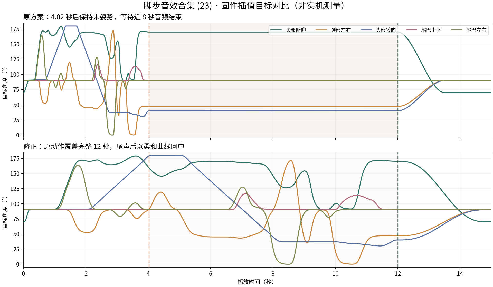

# 三款动作收势与恐龙脚步配套修正（2026-10-20）

本轮针对“恐龙后半段像卡住、所有动作突然归中”的反馈，修改播放时序、关键帧过渡和收势。三款仍保留各自轴序、机械限位、动作库、随机候选、手调配套优先、小智原生对话、双击会话、长按开机、电压／触摸状态页和手动 Audio Hub。

## 脚步音效合集 (23)

这份手调包的音频为 **11999ms**，动作记录为 **4020ms**、62 帧。原播放器在动作结束后保持最后姿势，直到音频结束，形成约 **7979ms 的静止等待**。用户贴出的两条 `SystemInfo` 是内存统计，本身没有报告分配失败或运动任务异常。

现在将较短的录制动作按音频长度展开：4020ms 原路径映射到 11999ms，不把剩余 8 秒填成末姿势。每组轴使用同一时间比例，角度方向保持，快速反复拨动产生的尖角经过固定窗口平滑。该配套在音频结束后，再以约 **2885ms** 的五次曲线归中，总长约 **14884ms**。回归测试检查了原先静止的后 8 秒，各个两秒窗口都继续出现动作。



曲线由修正前、后的实际 C++ 插值器导出，是软件目标而非实机测量；原始数据见[CSV](review/wzh_footsteps23_comparison_2026-10-20.csv)。52 套配套的音频与原始关键帧文件均未覆盖。

设备日志现在明确区分：

```text
Offline sound: 脚步音效合集 (23) (11999 ms), source=user-pair index=53
Pair timeline: recorded=4020 ms fitted=11999 ms; smooth settling follows
```

手动试听外置 Flash 中的同名声音时，日志标记为 `source=external-flash`，仍使用其独立通用编排。名称相同不能单凭旧日志判断播放来源。

## 三款共同的收势

- 手调配套：短于音频时平滑展开，长于音频时保留较慢原时长，不压缩成急动作；熊猫使用 70ms、恐龙使用 100ms 的固定平滑半窗，五轴同步，不追加镜像或另一组随机摆动。
- 表演与归中使用不同时间预算。归中采用五次曲线，起止速度与加速度归零，时长随最远关节的行程增加。配套／通用音画回中目标峰值上限：大熊猫 100°/s、小熊猫 75°/s、恐龙 65°/s。最终输出仍受现有物理限位和 400°/s 总上限约束。
- 停止、安静、退出对话等收尾取最后已下发的 PWM 角度，使用同类柔和曲线。恐龙待机回中再缓一些，为 60°/s；安静模式不会再对回中角度重复做幅度缩放，避免首帧向中位回跳。
- 播放时钟跨过结束点时，播放器交回运动任务，从最后输出开始收势；不再补发一个突然的默认姿态。下一段自动展示会等舵机完成收势、释放后，再计算 1.8～2.4 秒展示间隔。
- 两个熊猫的新动作从最后输出姿态进入；普通动作的归中关键帧也不再被通用快速时长压缩。爬爬熊猫的 800／1200ms 稳定爬行周期与原步幅保留，只放柔最终收势。

恐龙普通、参考、身体与互动动作统一保留至少 420ms 的移动段及不超过约 80°/s 的平均行程预算；归中段独立按更柔和的曲线计算。收尾不再从理想关键帧跳接，也不在动作刚结束时提前断电。原有大幅姿态保留，减少急转与急收。

正常长按关机也使用有限的柔和回中，最长 2.2 秒；电源任务留出 2.4 秒确认窗口。爬爬熊猫先退出爬行动作对 PWM 的占用，再回中。故障、跌落、严重低电等保护仍立即释放舵机，空闲关机不会为归中额外给舵机上电。

## 验证与固件

- **167 项主机测试通过**：包括 12 秒脚步后半段持续运动、配套与通用收势速度、错过结束帧后的接管、安静模式回中、三款关机截止时间、受保护／空闲状态断电，以及此前对话、状态页和音频选择回归。
- **1040 条通用随机轨迹**通过机械限位、速度、归中、多样性和卸力检查。自然收势会适当延长录音后的动作尾部，审计按本轮速度预算检查。
- **52 套手调轨迹**通过 5ms 目标采样、20ms 输出限速模拟、回中峰值速度及收尾残差检查。仍有少数源记录中的快速转折超过命令上限，实际命令受限速承接；模拟不能证明实机完全跟随。详见[配套轨迹审计](wzh_user_pair_motion_audit_2026-10-20.json)。
- 三款使用本机 ESP-IDF 6.0.1 构建打包；未安装 6.0.2。包内页面、52 份配套音频、产品身份及新增时序日志均核对，见[本轮固件清单](wzh_fluid_motion_firmware_2026-10-20.json)。

固件：[大熊猫](../releases/v2.4.1_wzh-crawlpanda.zip) · [小熊猫](../releases/v2.4.1_wzh-tailredpanda.zip) · [恐龙](../releases/v2.4.1_wzh-dinosaur.zip)。

本轮未烧录、未做实机验收。建议重点播放脚步 (23)，并连续检查普通动作结束、触摸打断、安静、退出对话和长按关机；确认关节同步、恐龙颈部与尾巴机械空间、扬声器同步、舵机电流，以及较长收势的实际观感。最后输出角度是命令记录，不代表有舵机位置反馈。
