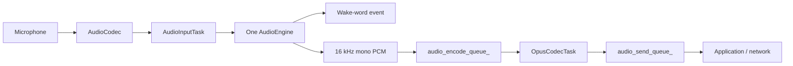

# Audio Service Architecture

`AudioService` owns one input engine and keeps codec I/O, Opus encoding/decoding,
and network queues independent from the chip-specific speech pipeline.

## Input engines

The old `AudioProcessor + WakeWord` combinations have been replaced by a single
`AudioEngine` interface. `AudioInputTask` reads PCM once and feeds exactly one
engine.

| Target | Engine | Wake word | Uplink processing |
| --- | --- | --- | --- |
| ESP32-S3 / ESP32-P4 / ESP32-S31 | `AfeAudioEngine` | WakeNet inside AFE, or MultiNet fed from AFE output | FD AEC + VAD when audio processing is enabled |
| ESP32 / ESP32-C3 / ESP32-C5 / ESP32-C6 | `LiteAudioEngine` | Standalone WakeNet when configured | Raw mono PCM |

`AfeAudioEngine` owns a single FD AFE instance. WakeNet and voice uplink share
that instance, so enabling both no longer creates two AFE pipelines. For custom
MultiNet wake words, AFE fetch output is passed to `CustomWakeWord`; MultiNet is
not created on the smaller targets.

With `USE_AFE_WAKE_WORD` and `WZH_OFFLINE_COMMANDS`, WakeNet handles conversation
wake-up while MultiNet handles only `local:*` commands from the same AFE fetch
output. There is still one capture path and one AFE instance. Kconfig selects the
primary detector; the presence of a MultiNet model no longer overrides WakeNet.
A WakeNet detection takes priority over a local command in the same frame and
clears partial MultiNet input. Local commands are dispatched through the existing
board-local event path without opening a network session. `CustomWakeWord` filters
out ordinary wake phrases in this mode, including those in older asset metadata.

The AFE configuration currently uses `AEC_MODE_VOIP_HIGH_PERF` with
`AEC_NLP_LEVEL_VERYAGGR`. WebRTC/NSNet noise suppression is intentionally
disabled because the project does not ship an NSNet model.

When wake-word audio upload is enabled, the most recent two seconds of PCM are
stored in a single 64 KB PSRAM ring buffer. WakeNet and MultiNet share the same
cache implementation, and the encoder reads it one Opus frame at a time. This
avoids the previous per-chunk internal-SRAM allocations and temporary PCM
concatenation buffer.
In combined WakeNet/local-command mode only the primary WakeNet detector uses
this cache; the local recognizer does not allocate a second audio-upload cache.

## Input data flow

Wake-word detection and voice processing are independent runtime states on the
same engine. On AFE targets, AEC stays active while wake-word detection is active
so playback reference remains available for wake-up during device playback. It
also stays active during voice processing when device AEC is requested.

## Output data flow

## Tasks and power management

- `AudioInputTask` reads codec input and feeds the selected engine.
- `AudioOutputTask` drains decoded PCM to the codec output.
- `OpusCodecTask` encodes uplink PCM and decodes downlink packets.
- `AfeAudioEngine` has its own AFE fetch task on S3/P4/S31.

The audio power timer still enables and disables codec ADC/DAC channels based on
activity; the engine refactor does not change that policy.

## Conversation and playback transitions

`Application::ToggleConversation()` is a complete session toggle for buttons:
Idle enters through Connecting, while Connecting/Listening/Speaking exits through
`StopInteraction(true)`. Existing `ToggleChatState()` keeps its original interrupt
and provisioning semantics for other boards. Stop/quiet/rest/shutdown use the silent
`StopInteraction()` default.

Application owns prompt ordering and conversation generations. Entry prompts play
after voice-processing initialization resets the decoder; exit prompts are queued
after cancellation and before Idle admits local sound. The TTS-start handler resets
the decoder before publishing Speaking, so a deferred state event cannot discard
already accepted first packets. Scheduled TTS/STT/emotion/close work is rejected
when its conversation has been superseded.

AudioService owns the single speaker output task. Local Flash and prompt producers
only enqueue packets; each binds to the current decoder generation, and decoded
PCM carries that generation through output admission. Cancelled PCM does not feed
motion envelopes. Hardware frames already handed to I2S may have a short physical
tail; output-stop latency, VAD, interruption and AEC still require device tests.

## Persistent output volume

`AudioCodec::Start()` accepts persisted output volume 0 as intentional mute and
clamps saved values to 0..100. The WZH developer console applies changes through
the main task using the existing codec and NVS key; it does not open a second
audio driver. WZH boards also expose the optional `IsAudioMaintenanceActive()`
gate so an external-audio Flash erase cannot open a competing conversation.

## Local-interaction playback headroom (2026-10-21)

Boards advertising `SupportsLocalInteraction()` use output priority 6 and Opus
priority 5 (motion remains 2, capture remains 8). Other boards retain the original
priorities and queue budgets. These boards admit up to 96 compressed packets and
6 PCM frames; both queues remain bounded. The compressed budget absorbs larger
TTS bursts without blocking the WebSocket/MQTT callback. The status page reports
queue-full events; these events include waiting producers, so they are not a
count of dropped packets.

`AudioPlayoutBuffer` admits a 120ms prefix, with an 80ms maximum wait for a short
prompt. Subsequent packets run immediately while the estimated I2S playback
horizon still contains sound. A gap beyond that horizon triggers another bounded
prefill. Generation reset and stop wake the condition-variable wait immediately;
there is no second speaker writer or independent decoder. Rebuffer counters also
include normal sentence pauses and gaps between local files; they do not prove
network packet loss. These changes do not alter either transport's packet format.

Robot envelope listeners receive the fast PCM envelope (about 100ms attack)
instead of the 1.7-second baseline; the baseline is still used for accent
measurement. The board motion follower provides its own damping. Other listener
behavior is unchanged. Actual speech, interruption/reconnect, VAD/AEC and power
integrity still need a device listening test.
