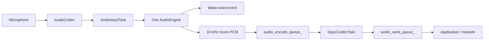

# Audio Service Architecture

`AudioService` owns one input engine and keeps codec I/O, Opus encoding/decoding,
and network queues independent from the chip-specific speech pipeline.

WZH boards optionally provide `ExternalTts` and `VoiceEnrollment` through `Board`.
Their shared Ali implementation and console live under `boards/common/wzh/`;
other boards default to neither capability. See
[voice cloning and management](../../docs/wzh/audio/voice_cloning.md) for setup and validation.
Processed enrollment frames are consumed before debug taps and uplink encoding.
Native PCM uses the same bounded playback queue, output task, gain protection and
AEC reference as other audio; finishing a PCM stream is bound to its playback
generation so a cancelled worker cannot finish a newer reply.

## Input engines

The old `AudioProcessor + WakeWord` combinations have been replaced by a single
`AudioEngine` interface. `AudioInputTask` reads PCM once and feeds exactly one
engine.

| Target | Engine | Wake word | Uplink processing |
| --- | --- | --- | --- |
| ESP32-S3 / ESP32-P4 / ESP32-S31 | `AfeAudioEngine` | WakeNet inside AFE, or MultiNet fed from AFE output | FD AEC + VAD when audio processing is enabled |
| ESP32 / ESP32-C3 / ESP32-C5 / ESP32-C6 | `LiteAudioEngine` | Standalone WakeNet when configured | Raw mono PCM |

`AfeAudioEngine` owns a single FD AFE instance. WakeNet and voice uplink share
that instance, so enabling both no longer creates two AFE pipelines. For custom
MultiNet wake words, AFE fetch output is passed to `CustomWakeWord`; MultiNet is
not created on the smaller targets.

With `USE_AFE_WAKE_WORD` and `WZH_OFFLINE_COMMANDS`, WakeNet handles conversation
wake-up while MultiNet handles only `local:*` commands from the same AFE fetch
output. There is still one capture path and one AFE instance. Kconfig selects the
primary detector; the presence of a MultiNet model no longer overrides WakeNet.
A WakeNet detection takes priority over a local command in the same frame and
clears partial MultiNet input. Local commands are dispatched through the existing
board-local event path. Each WZH product also maps its own MultiNet name phrase
to the existing conversation wake path; the other products' names are not
included in that product's vocabulary. `CustomWakeWord` filters out untagged
wake phrases in this mode, including those in older asset metadata.

The three normal WZH products use the existing keyword-confirmed interruption
gate and the same interruption vocabulary. A recognized keyword must coincide
with a recent near-end candidate; the gate still rejects echo and stale events.
The Chinese command vocabulary uses pinyin without tone numbers; tone-number
permutations are not valid MultiNet commands. To accommodate short syllable
boundaries, keyword-confirmed candidates retain verified speech across at most
120 ms total of VAD/energy gaps. The gaps do not count toward the required
near-end speech; clipping, missing playback reference and correlated echo still
apply their existing checks.
The two pandas use the lightweight WebRTC frontend for this mode because the
neural frontend pauses the secondary MultiNet detector during voice processing.
Recognition accuracy, CPU headroom and echo behavior require device testing.

The default AFE configuration uses `AEC_MODE_VOIP_HIGH_PERF` with
`AEC_NLP_LEVEL_VERYAGGR`; the voice-barge-in variant uses `AEC_MODE_FD_HIGH_PERF`.
AFE-internal noise suppression is disabled. The optional neural uplink runs a
separate NSNet2 stage after AEC and requires its model in the matching assets.

When wake-word audio upload is enabled, the most recent two seconds of PCM are
stored in a single 64 KB PSRAM ring buffer. WakeNet and MultiNet share the same
cache implementation, and the encoder reads it one Opus frame at a time. This
avoids the previous per-chunk internal-SRAM allocations and temporary PCM
concatenation buffer.
In combined WakeNet/local-command mode only the primary WakeNet detector uses
this cache; the local recognizer does not allocate a second audio-upload cache.

## Input data flow

Wake-word detection and voice processing are independent runtime states on the
same engine. On AFE targets, AEC stays active while wake-word detection is active
so playback reference remains available for wake-up during device playback. It
also stays active during voice processing when device AEC is requested.

## Output data flow

All PCM, including TTS, music and local sounds, leaves through
`AudioCodec::OutputData`. Robot boards enable `SpeakerProtection` there: a
120 Hz second-order high-pass drops bass the small driver cannot reproduce, a
short-term RMS guard trims dense music by up to 4 dB while leaving speech
untouched, and a 1 ms look-ahead peak limiter holds peaks around -1.5 dBFS
before the codec DAC. Other boards keep the untouched stream.

2026-11-07 WZH maximum-volume correction: the V4-2.2 NS4150 input resistors
R35/R37 are 30 kohm, giving 20 dB PA gain. WZH now passes that gain to ES8311's
existing hardware compensation and used a -3 dB maximum route target, with the
original 0..80 curve and a gentler 80..100 segment. The stored UI value remains
0..100, but the DAC level is lower at the same setting (23 dB at 100 relative
to the previous uncorrected configuration). The curve is restored on every
device reopen. Other boards retain the original constructor defaults and curve.
This corrects gain staging; it is not measured acoustic acceptance. See
`docs/wzh/audio/wzh_volume100_audio_2026-11-07.md` for research, registers and validation.

2026-11-09 second loudness adjustment: the WZH high-volume route now ends at
-2 dB instead of -3 dB; the 0–80 curve and digital peak/RMS guards are
unchanged. At volume 100 the ES8311 DAC target changes from -23 to -22 dB
with the 20 dB PA compensation. This is a 1 dB nominal increase, not a measured
SPL or guarantee against analog clipping. Real-device playback, power, heat,
voice interruption and distortion testing is required on all three products.

2026-11-09 follow-up: WZH board profiles use 12 dB pre-limiter makeup instead of
9 dB. That revision kept the DAC maximum and peak/RMS protection unchanged. A comparison of
12 bundled voice prompts measured +0.5 to +1.5 LU digitally, with sample peaks
at or below 27524. This is a trial pending speaker, power and interruption tests
on each device; it does not establish acoustic distortion or sound pressure.

2026-11-07 loudness follow-up: hardware feedback found volume 100 too quiet.
That revision added 9 dB of makeup before the RMS guard and peak limiter. This profile
uses RMS-before-limiter routing and the existing 1 ms FIR gain smoothing even
without speech EQ, plus a 5 ms startup ramp. The 20 dB PA compensation, DAC
ceiling and 0.84 PCM peak limit remain unchanged. The default is 0 dB on other
boards, whose output matches the previous implementation in the offline cases.
Existing speech samples gained 3.3..5.7 LU in the digital comparison; this is
not measured speaker SPL or acoustic acceptance. See
`docs/wzh/audio/wzh_loudness_recovery_2026-11-07.md` and the comparison WAV files.

2026-11-04 music-quality revision: `AUDIO_SPEAKER_SMOOTH_LIMITER` optionally
averages the peak-constrained gains over the existing 1 ms look-ahead. Both tail
red panda variants enable it; other variants default off. The bounded Q20 FIR
reduces attack steps without changing volume, EQ, RMS/peak limits or PCM delay.
The codec task also emits aggregate `Opus quality:` diagnostics about every three
seconds of decoded PCM: coded TOC bandwidth/channel flags, payload bitrate and
pre-EQ rail samples. This observes all decoded Opus (including local sounds),
retains no audio, and does not identify music from assistant text. Hardware
listening and CPU/timing acceptance remain pending. See
`docs/wzh/archive/2026-11/wzh_tailredpanda_music_quality_2026-11-04.md`.

## Tasks and power management

- `AudioInputTask` reads codec input and feeds the selected engine.
- `AudioOutputTask` drains decoded PCM to the codec output.
- `OpusCodecTask` encodes uplink PCM and decodes downlink packets.
- Downlink resampling uses the highest rate-converter quality; the negotiated
  server rate is logged as `Server audio: ... Hz` on connection.
- `AfeAudioEngine` has its own AFE fetch task on S3/P4/S31.

The audio power timer still enables and disables codec ADC/DAC channels based on
activity; the engine refactor does not change that policy.

## Conversation and playback transitions

`Application::ToggleConversation()` is a complete session toggle for buttons:
Idle enters through Connecting, while Connecting/Listening/Speaking exits through
`StopInteraction(true)`. Existing `ToggleChatState()` keeps its original interrupt
and provisioning semantics for other boards. Stop/quiet/rest/shutdown use the silent
`StopInteraction()` default.

Application owns prompt ordering and conversation generations. Entry prompts play
after voice-processing initialization resets the decoder; exit prompts are queued
after cancellation and before Idle admits local sound. WZH boards supply a distinct
descending exit cue through the optional `Board::GetConversationExitSound()`;
entry retains the original popup, and other boards retain the default cue.
The exit asset is bundled only in WZH firmware. Silent stops and stale-session
cancellation retain their existing behavior. See
`docs/wzh/audio/wzh_conversation_sounds_2026-11-07.md` for validation and listening checks.
The TTS-start handler resets
the decoder before publishing Speaking, so a deferred state event cannot discard
already accepted first packets. Scheduled TTS/STT/emotion/close work is rejected
when its conversation has been superseded.

AudioService owns the single speaker output task. Local Flash and prompt producers
only enqueue packets; each binds to the current decoder generation, and decoded
PCM carries that generation through output admission. Cancelled PCM does not feed
motion envelopes. Hardware frames already handed to I2S may have a short physical
tail; output-stop latency, VAD, interruption and AEC still require device tests.

## Persistent output volume

`AudioCodec::Start()` accepts persisted output volume 0 as intentional mute and
clamps saved values to 0..100. The WZH developer console applies changes through
the main task using the existing codec and NVS key; it does not open a second
audio driver. WZH boards also expose the optional `IsAudioMaintenanceActive()`
gate so an external-audio Flash erase cannot open a competing conversation.

## Local-interaction playback headroom (2026-10-21)

Boards advertising `SupportsLocalInteraction()` use output priority 6 and Opus
priority 5 (motion remains 2, capture remains 8). Other boards retain the original
priorities and queue budgets. These boards admit up to 96 compressed packets and
6 PCM frames; both queues remain bounded. The compressed budget absorbs larger
TTS bursts without blocking the WebSocket/MQTT callback. The status page reports
queue-full events; these events include waiting producers, so they are not a
count of dropped packets.

`AudioPlayoutBuffer` admits a 120ms prefix, with an 80ms maximum wait for a short
prompt. Subsequent packets run immediately while the estimated I2S playback
horizon still contains sound. A gap beyond that horizon triggers another bounded
prefill. Generation reset and stop wake the condition-variable wait immediately;
there is no second speaker writer or independent decoder. Rebuffer counters also
include normal sentence pauses and gaps between local files; they do not prove
network packet loss. These changes do not alter either transport's packet format.

Robot envelope listeners receive the fast PCM envelope (about 100ms attack)
instead of the 1.7-second baseline; the baseline is still used for accent
measurement. The board motion follower provides its own damping. Other listener
behavior is unchanged. Actual speech, interruption/reconnect, VAD/AEC and power
integrity still need a device listening test.

## Fixed-capacity queues and conversion buffers (2026-11-02)

Following upstream `ac6deed`, service queues now use `FixedQueue` storage and hold
`AudioTask` values directly. Live robot admission remains 96 compressed packets
and 6 PCM frames, with the existing 120 ms / 80 ms playout policy and generation
fences. Both recording and decode storage can hold all 166 packets from a
10-second audio test; transferring that recording does not truncate it to the
live conversation budget. Capture and network producers retain their bounded
nonblocking/drop policies. Server-AEC timestamps retain the newest three values.

Opus encodes directly into the outgoing packet payload. Downlink rate conversion
reuses its decoder-source scratch buffer, and closes a no-longer-needed converter
when playback returns to the codec's native rate. The existing quality setting
and 24 kHz WZH hardware rate are unchanged.

Following upstream `7aa9266`, the AFE processing task uses a statically created
4096-byte stack, preferring PSRAM only when external task stacks are enabled.
Internal RAM remains the fallback. WakeNet/local-MultiNet routing, AFE/AEC modes,
model selection and capture priorities are unchanged.

## Speaker processing ownership (2026-11-02)

Peak detection maintains a monotonic ring over the 1 ms look-ahead plus the
sample currently leaving the delay. It replaces the per-sample window scan and
attenuates before transients reach the DAC. RMS gain targets update every 16
samples rather than calculating a square root for every sample. Processing
performs no heap allocations; the delay and peak rings allocate at initialization.
The 120 Hz high-pass, -1.5 dBFS peak ceiling, maximum 4 dB RMS attenuation and
release constants retain the existing small-speaker policy.

DAC-off and conversation-generation changes request a DSP reset atomically. Only
`AudioOutputTask` applies it, before writing the next PCM, so timer callbacks do
not mutate the filter while it is processing and old delayed samples cannot enter
a new session. Audio already handed to hardware retains its physical DMA tail.
Host waveform tests cover 8/16/24/48 kHz, fragmented processing and cancellation;
actual loudness, timbre, latency, power integrity and applicable AEC require a
physical device.

## Opt-in speaker voice clarity (2026-11-04)

The later `AUDIO_PRODUCT_QUALITY` candidate adds bounded source calibration for
known tail-panda assets, local Opus preskip/end trim/header gain, writer-owned
smooth endings and reusable quality-3 capture conversion. Microphone encoding
uses an explicit 32 kbps VBR / complexity-3 budget. It defaults off and is enabled
only in the two tail-panda variants. These changes preserve physical codec rates,
stored volume and speaker protection; they do not change official cloud music
encoding. Container metadata remains local to `AudioStreamPacket`, with both
transport wire formats unchanged. Full measurements, host/build validation and
the pending listening/real-time acceptance are recorded in
`docs/wzh/archive/2026-11/wzh_tailredpanda_product_audio_2026-11-04.md`.

`AUDIO_SPEAKER_VOICE_CLARITY` is enabled in both tail-red-panda variants and
defaults off elsewhere. It applies only to the existing protected speaker path.
The profile uses peaking EQ at 300 Hz (-1 dB, Q 0.8) and 2.5 kHz (+2 dB,
Q 0.8), with 0.5 dB makeup before protection. These are conservative trial
settings, not a measured correction for every speaker enclosure.

In this profile, RMS attenuation is applied before the look-ahead peak detector,
so the peak limiter measures the signal that will reach the DAC rather than
unnecessarily multiplying two gains computed from unattenuated peaks. The
sample peak ceiling, RMS threshold/floor and release constants are retained.
A 5 ms smoothstep starts on the first delayed sample after a DSP reset and does
not repeat at packet boundaries. Coefficients are computed at initialization;
the sample loop allocates no memory. PCM duration/rate and stored volume are
unchanged. The ES8311 DAC reference still follows the processed playback.

Offline comparisons of seven bundled Chinese prompts measured loudness changes
of -0.16 to +0.43 LU and no int16 clipping. This is a small digital-signal
comparison, not a loudspeaker listening or distortion test. See
`docs/wzh/archive/2026-11/wzh_tailredpanda_audio_quality_2026-11-04.md` for research, validation and
physical acceptance. Voice interruption remains an unaccepted experiment.

## Opt-in local voice interruption (2026-11-02)

2026-11-07: `wzh-crawlpanda-barge-in` and `wzh-dinosaur-barge-in` now use the
same reference capture and interruption route as the tail-red-panda trial.
Their ordinary variants explicitly disable interruption and the neural frontend.
Wake models, physical board selectors and pins retain each product's identity.
See `docs/wzh/audio/wzh_voice_barge_in_2026-11-07.md` for builds, self-review and the
remaining hardware acceptance checks.

2026-11-04 voice-guard follow-up: in `USE_VOICE_BARGE_IN` builds, WakeNet events
during Speaking/Listening re-arm detection without cancelling playback, resetting
capture or clearing the reply gate. Conversation interruption must use confirmed
near-end speech; standby wake-up and non-barge-in builds keep their previous
behavior. This closes an alternate cancellation path, not the acoustic acceptance
gap. See `docs/wzh/archive/2026-11/wzh_tailredpanda_voice_guard_2026-11-04.md`.

2026-11-04: hardware feedback found the NSNet2/VADNet candidate overran its
32 ms budget, overflowed AFE input and starved CPU 1's idle task. The revised
`VOICE_BARGE_IN_NEURAL_FRONTEND` route retains post-AEC NSNet2, replaces the
second neural network with WebRTC VAD (160-sample/10 ms framing), and pauses
secondary offline MultiNet commands while voice processing is active. Primary
WakeNet remains enabled by its existing controls; primary MultiNet configurations
are unaffected. Secondary commands resume with cleared partial input in standby.
Only NSNet2 weights are required by this route. The AFE's pre-NSNet VAD is not
reused for the enhanced uplink. All VAD chunks must agree across each 60 ms
encoded frame; session generation is rechecked after inference. Missing models
disable automatic interruption admission while retaining normal AFE capture.
Average/max post-processing time is logged every 64 input frames; this is not a
measurement of total AFE CPU use. Speaker settings and watchdogs are preserved.
This revised candidate still requires hardware timing and acoustic acceptance;
see `docs/wzh/archive/2026-11/wzh_tailredpanda_barge_in_realtime_2026-11-04.md` and the earlier
research in `docs/wzh/archive/2026-11/wzh_tailredpanda_neural_barge_in_2026-11-04.md`.

Hardware feedback on 2026-11-03 found both self-interruption and missed speech
in the experimental builds. The waveform correlation veto is a heuristic;
decorrelated residual echo can pass it. This feature has not passed hardware
acceptance. Current AEC/output gain changes are under live diagnostic testing.

`USE_VOICE_BARGE_IN` is enabled by the three WZH `*-barge-in` test variants.
ES8311 captures interleaved ADCL microphone / DACR reference through
its existing I2S connection. The shared codec opens both physical slots, while
`Write()` explicitly duplicates logical mono PCM into them. A single FD AFE
provides local AEC, VAD, WakeNet and local MultiNet; ordinary builds keep their
existing capture format and AFE mode.

During TTS the AFE remains active, and up to 12 compressed post-AEC packets
(720 ms) are retained locally. Fresh reference and unclipped ADC input are
required. After 300 ms of referenced, unclipped output, VAD and 180 ms of energy
above a bounded 160–480 RMS noise floor confirm independent near-end speech.
One echo-vetoed 60 ms frame can be skipped within that candidate; it never
counts as voice, and sustained echo clears the candidate.
A 512 ms reference ring is box-filtered to 2 kHz; normalized correlation over
possible delays vetoes residual playback at a score of 0.55 or higher. Missing
or non-audio reference does not count as near-end speech. Matching uses 4 KB
of fixed history and no per-frame allocation; actual S3 timing needs measurement.
The previous trial used FD_HIGH_PERF/AGGR AEC, VAD_MODE_2, 6 dB ADC gain and 4x
AFE output gain. The current diagnostic comparison uses VERYAGGR and unity
output gain. Reference gaps and isolated clipping invalidate candidates without
discarding completed settling. A capture stall over 120 ms restarts settling
and clears reference history. Capture and reply generations
reject stale work. Only the main task cancels playback and
sends abort/listen commands; it stops locally before sending over the network.
The main task accepts the detection and commits the clean prefix under the
capture lock before stopping playback, so intentional reference loss during
abort does not invalidate an accepted detection. The prefix precedes subsequent
microphone packets without restarting capture. No extra decoder or speaker
writer is created.

The reply gate requires the server's next nonempty STT before accepting new TTS,
using the existing auto protocol on both transports. Current-frame VAD reaches
the detector before PCM; only VAD edges reach the UI. Normal TTS completion drops
the monitoring prefix and returns to ordinary listening. Wake-word/manual exit,
maintenance, no-reference and feature-disabled paths remain available.
See `docs/wzh/archive/2026-11/wzh_tailredpanda_voice_barge_in_2026-11-03-v2.md` for the liveness
fix and `docs/wzh/archive/2026-11/wzh_tailredpanda_voice_barge_in_2026-11-02.md` for protocol
ordering requirements and physical-device acceptance checks.

`AUDIO_DEBUG_PACKETIZED` adds a versioned XDBG trace to the existing optional
UDP debugger. It sends resampled input plus processed mono/VAD, using packets
of at most 672 bytes and nonblocking sends. Sequence/sample positions expose
loss; the configured time limit starts at the first successful send. Legacy
raw UDP remains the default. `VOICE_BARGE_IN_SHADOW` suppresses automatic abort
and starts trace output only while a reply is being monitored. These diagnostic
switches default off; a destination address belongs in a local build config.
Receive locally with `scripts/audio_debug_capture.py`.
