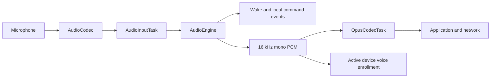
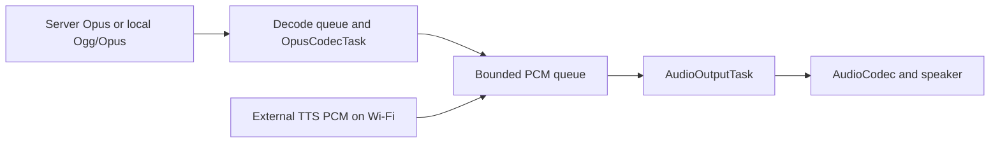

# Audio Service Architecture

[AudioService](audio_service.cc) owns capture, Opus encoding and decoding, and physical playback. The selected [AudioEngine](audio_engine.h) handles speech processing and wake detection. [Application](../application.cc) owns conversation state, session generations, and server control messages. Boards provide codec I/O and optional product capabilities through [Board](../boards/common/board.h).

## Capture and recognition

| Targets | Engine | Recognition and processing |
| --- | --- | --- |
| ESP32-S3 / ESP32-P4 / ESP32-S31 | [AfeAudioEngine](engines/afe_audio_engine.cc) | WakeNet inside the AFE, or MultiNet fed from AFE output. AEC uses the playback reference if the codec provides one. |
| ESP32 / ESP32-C3 / ESP32-C5 / ESP32-C6 | [LiteAudioEngine](engines/lite_audio_engine.cc) | Standalone WakeNet when configured and mono PCM uplink. |

On AFE targets, capture and recognition share one AFE instance. Kconfig selects the primary detector. The three WZH products use AFE WakeNet for standby wake-up and a secondary MultiNet 7 model for tagged `local:*` commands, including the product's short name. WakeNet takes priority if both detectors recognize the same frame. WZH release configurations disable wake audio upload. Builds that enable it cache up to two seconds in one 64 KB PSRAM ring for the active wake detector. [Wake and command vocabulary](../../docs/wzh/audio/voice_commands.md) · [Model packaging](../../docs/wzh/audio/wzh_wake_model_pairing_2026-11-11.md)

The WZH codec runs at 24 kHz, with interleaved microphone and DAC playback reference for AEC. The service converts capture to 16 kHz before the engine and reuses storage for its 10 ms input blocks. Larger diagnostic recording blocks use temporary storage. The optional enrollment callback consumes processed mono PCM before debug taps or uplink encoding. [Voice enrollment and playback](../../docs/wzh/audio/voice_cloning.md)

## Conversation and interruption

WZH builds use FD AEC (`AEC_MODE_FD_HIGH_PERF`, `AEC_NLP_LEVEL_VERYAGGR`), WebRTC VAD and keyword-confirmed interruption. Other AFE builds can use `AEC_MODE_VOIP_HIGH_PERF`. The optional post-AEC NSNet2 frontend has a separate model and pauses secondary MultiNet while voice processing is active. The WZH variants use the lightweight path so MultiNet can recognize interruption words during playback. [AFE configuration](engines/afe_audio_engine.cc)

During a reply, the service monitors near-end speech using VAD, levels, clipping and playback-reference correlation. An accepted interruption requires a recent near-end candidate and a configured keyword. The keyword and AEC candidate can arrive in either order. Up to 12 buffered post-AEC Opus packets can be retained for the next turn. Application commits this prefix before cancelling playback and requires the server's next nonempty transcript before admitting its next reply. [Interruption gate](voice_barge_in.h) · [Supported interruption phrases](../../docs/wzh/audio/voice_commands.md)

WZH double-click enters or exits via `ToggleConversation()`. In auto-listen mode the entry cue plays before starting capture. Exiting cancels old audio and enqueues the separate exit cue before returning to Idle. Rest, quiet and shutdown use the silent stop path. The TTS start transition holds the early-audio lock while resetting the decoder and admitting buffered packets. Playback and conversation generations reject stale callbacks and PCM after an interruption, stop or protocol replacement. [Conversation cues](../../docs/wzh/audio/wzh_conversation_sounds_2026-11-07.md)

## Playback and queue limits

`AudioOutputTask` is the only writer to the speaker. Local Flash sounds, built-in prompts, server TTS and external TTS bind to a playback generation. Wi-Fi external synthesis enqueues native-rate PCM. Dinosaur 4G synthesis requests Ogg/Opus and uses the same decoder queue as other compressed sources. The output task emits the real PCM envelope used by motion. An interruption cannot retract samples already handed to I2S DMA. [Dinosaur 4G](../../docs/wzh/hardware/dinosaur_ml307_2026-11-15.md)

| Path | Encoded queue | PCM queue | Initial target / recovery target / maximum wait |
| --- | ---: | ---: | --- |
| WZH Wi-Fi and local audio by default | 96 packets | 6 frames | 120 ms / 120 ms / 80 ms |
| Dinosaur cellular conversation | 96 packets | 6 frames | 360 ms / 480 ms / 480 ms |
| Boards without local-interaction playback | 2.4 seconds of packets | 2 frames | No prefilling |

During prefill, a full PCM queue can count consecutive queued Opus packets whose parsed frame duration matches the decoder format. Playback starts when the combined queue reaches the target or the wait expires. Only PCM written to the codec advances the estimated playback horizon. Cellular playback uses the deeper recovery target after a gap beyond that horizon to reduce repeated stalls.

`FixedQueue` provides fixed-capacity storage. The active decode budget is separate from the storage used to play back a full 10-second recording test. Network callbacks enqueue without waiting. Capture drops stale work if its realtime queue fills. Server-AEC builds retain up to three playback timestamps. Audio service resets wake queue waiters and fence off in-flight decode. Rebuffer and queue-full counters also capture normal pauses and waiting producers. [Queue definitions](audio_service.h) · [Playout policy](audio_playout_buffer.h)

## Speaker path

The WZH ES8311 boards use the NS4150 at 3.3 V, with 20 dB PA compensation and a −0.5 dB route target at volume 100. The DSP applies a 120 Hz high-pass, RMS protection and a 1 ms look-ahead limiter with a 0.84 PCM peak ceiling. Board profiles supply 27 dB pre-limiter makeup on the two pandas and 30 dB on the dinosaur. The microphone gain in reference capture mode is 18 dB for the pandas and 12 dB for the dinosaur. The saved volume accepts 0 as mute and clamps to 0–100. [ES8311 configuration](codecs/es8311_audio_codec.cc) · [DSP](speaker_protection.h)

Both red-panda variants also use the optional speech EQ, smoothed limiter and product-quality codec path. The codec path handles local Ogg preskip, end trim and OpusHead gain and uses 32 kbps VBR microphone encoding. Speaker filter/reset state is owned by the output writer. The power timer requests codec input and output shutdown based on inactivity. Earlier loudness values and digital comparisons are recorded in the dated engineering reports. [Loudness measurements](../../docs/wzh/audio/pandas_loudness_2026-11-11.md) · [Amplifier compensation](../../docs/wzh/audio/wzh_volume100_audio_2026-11-07.md)

## Diagnostics and acceptance

For debug builds, `AUDIO_DEBUG_PACKETIZED` uses versioned XDBG traces for resampled input, processed mono and VAD. `VOICE_BARGE_IN_SHADOW` records the monitoring interval without automatic abort. Receive locally with [audio_debug_capture.py](../../scripts/audio_debug_capture.py). The normal WZH variants ship with debugger and shadow mode disabled.

Host tests exercise queue bounds, playback generations, waveform protection, VAD/keyword admission and transitions. Device acceptance covers capture, speech and music playback, mute and volume 100, wake/VAD, interruption and echo, AEC, reconnect, power integrity, and actual motion and sound timing. [Product acceptance](../../docs/wzh/product/product_acceptance.md)
