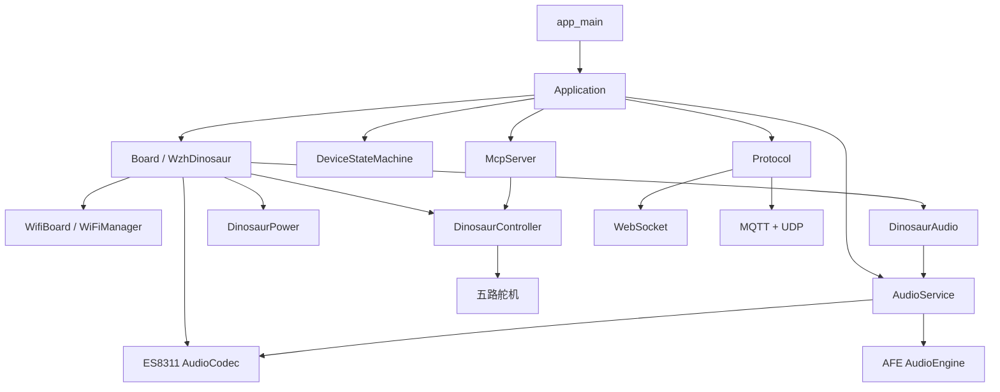
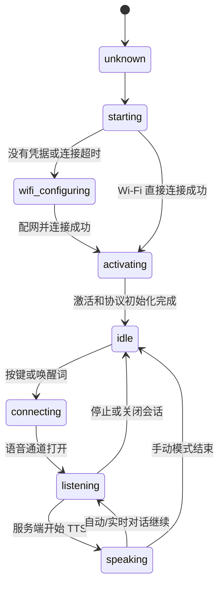
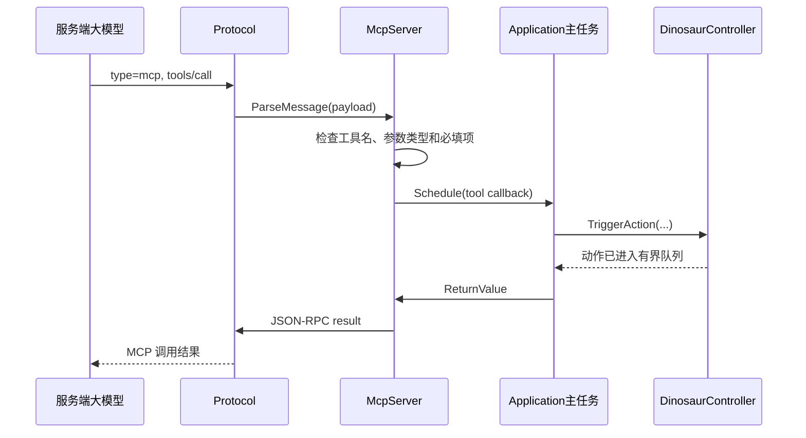
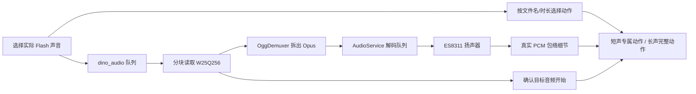
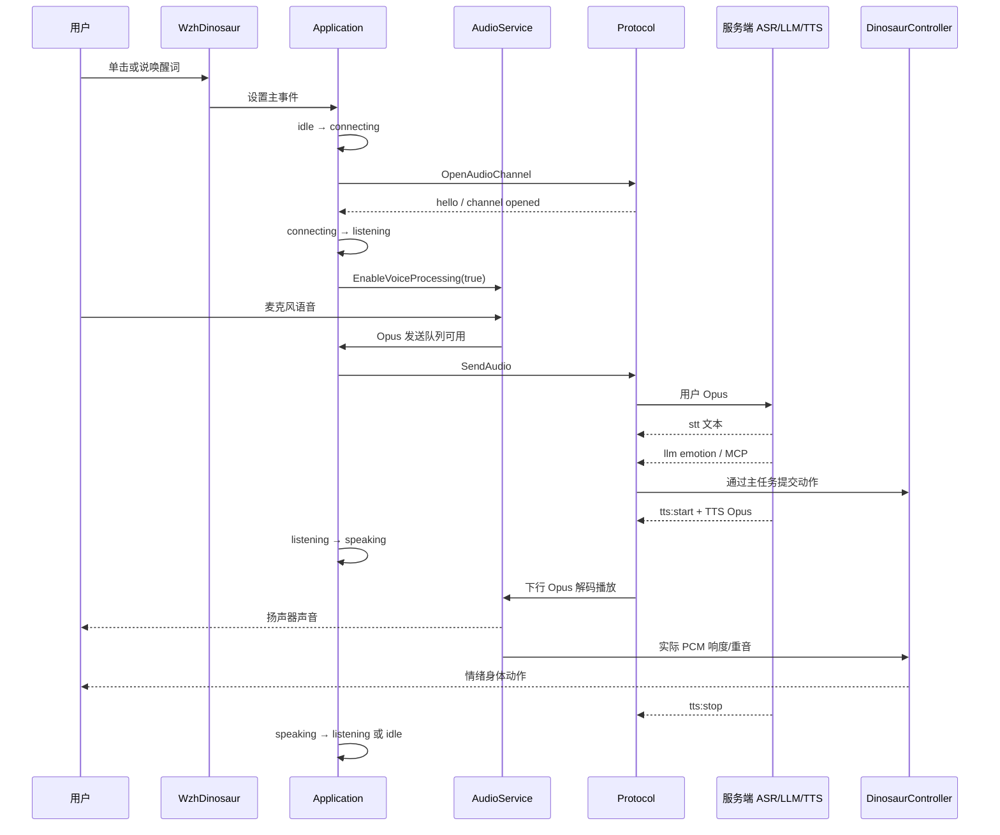
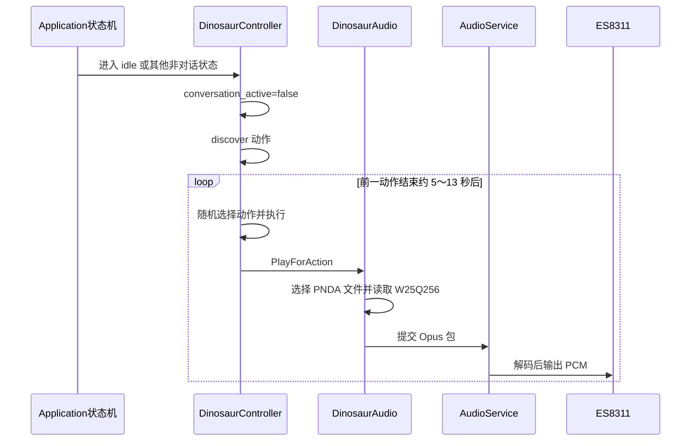

# XiaoZhi 工程运行原理（WZH Dinosaur 版本）

2026-10-21 离线动作更新：三款动作表现再优化；恐龙四段完整编舞增加独立回看与高低对比，配套仰天吼叫后的侧看更明显。最新说明、验证与固件见[离线动作说明](../../../docs/wzh_offline_personality_2026-10-21.md)。以下同日记录为此前版本。

2026-10-21 活力与对话断音修正：三款启用有界播放缓冲、提高解码／输出优先级，并加快真实语音动作响应；恐龙正常动作节奏与颈尾幅度加强。最新参数、验证及固件见[本轮说明](../../../docs/wzh_vitality_audio_2026-10-21.md)，下方为较早记录。

2026-10-21 音画表现更新：三款每个 Flash 音频与手调配套均扩展为 32 种随机变化，对话随动 16 种组合；大熊猫独立爪部、小熊猫高尾连续弧、恐龙仰天吼叫与低位取食同步优化。180 项主机测试与三款编译打包均通过，未烧录；本轮固件及轨迹对比见[音画表现说明](../../../docs/wzh_expressive_audio_2026-10-21.md)。下方内容按日期为历史记录。

2026-10-21 三款编译验证已通过，含当前关节语音、熊猫头部范围、常规电池保护与静置电压、90°C／85°C 温度保护。使用 ESP-IDF v6.0.1，未烧录。固件与校验见[最新编译结果](../../../docs/wzh_build_2026-10-21.md)。下方“未编译”说明为修改阶段记录。

2026-10-21 电池源码更新：三款启用常规 3.30V／3.40V／3.00V 保护；普通低电取时间中值并连续确认，恢复要求静置，页面电压与电量在舵机断电且播放结束后稳定采样更新。未编译、未烧录。见[参数、时序与验证](../../../docs/wzh_battery_rest_2026-10-21.md)。

2026-10-21：33 类关节动作统一接入本地关键词与原生小智 MCP；云端 STT 不抢先重复执行，明确指令暂停语音动作叠加。源码更新，未编译、未烧录。见[口令、接口与识别资源说明](../../../docs/wzh_joint_voice_2026-10-21.md)。

2026-10-20 新动作源码：参考例程的真实动作参与本地音画，配套增加随机表达与连续平滑；原生对话头部按句子凝视。按用户要求未编译，现有包是上一轮版本。详见[本轮说明](../../../docs/wzh_reference_expression_2026-10-20.md)。

2026-10-20 最新：脚步 (23) 的 4020ms 动作覆盖完整 11999ms 音频，约 2885ms 柔和归中；普通动作、安静／退出、关机收势统一改善。详见[平滑收势与验证](../../../docs/wzh_fluid_motion_2026-10-20.md)。

2026-10-20 当前：24 套手调配套优先、29 段参考动作保留、普通随机方向均衡、冷启动有效长按 1 秒；详见[本轮实现与验证](../../../docs/wzh_user_pairs_natural_motion_2026-10-20.md)。以下较早说明以此为准。

2026-10-19 整套动作增强：扩大中间行程和头爪/头尾配合，对话扩展为 8 种组合、每种句子风格独立洗牌；三款 461 个库入口回放通过，音画动作合计摆幅提升约 11%～16%。详见[最新动作表现说明](../../../docs/wzh_broad_expression_2026-10-19.md)。

2026-10-19 同音频随机动作：通用录音每文件 8 套独立洗牌，轮内抽全、跨轮不紧接重复；恐龙吼声按时长 3／4 套独立洗牌，短声增加可见抬尾差异。详见[最新随机动作说明](../../../docs/wzh_random_sound_motion_2026-10-19.md)。

2026-10-19 三款动作更新：新增24段情景编舞，互动各5套，录音通用编排8种变化，对话采用6种语句动作组合。当前动作数量与验证见[灵动动作说明](../../../docs/wzh_lively_motion_2026-10-19.md)。

2026-10-19 双击对话版：电源键与BOOT键均为“双击进入，再双击完整退出”，覆盖连接／收音／回复状态；正常运行单击不再启动对话。进入提示在本地音效停止和收音初始化之后播放，退出清理旧提示、回复及排队PCM；退出后可重新对话，或按既有空闲间隔恢复本地音画展示。详见[双击对话与扬声器衔接](../../../docs/wzh_double_click_conversation_2026-10-19.md)。

2026-10-19 当前客户展示音画方案：正常空闲约2秒后播放音频配对动作；大小熊猫18段动物音轮内不重复，长环境音关闭自动播放；恐龙27段全部覆盖、环境音自动取12秒。11类互动各配两段真实录音，动作按逐文件时长与包络编排，小熊猫加强高翘尾，三款增强真实对话随动。触摸、唤醒、停止、安静与保护优先。下方静置安静等旧规则以[当前方案与逐文件表](../../../docs/wzh_audio_choreography_2026-10-19.md)为准；可用[声音动作预览](../../../docs/wzh_audio_motion_preview.html)复核。

2026-10-19 参考动作库迁移与扩展：三款共迁入 86 段参考编舞、新增 24 段故事动作；11 类触摸/姿态回应各有四个候选（44 个入口）。新动作保留大幅行程、不同节拍和连续衔接，完成后回各自默认姿态。恐龙完整动作池使用族内不放回洗牌；静置安静、原身体指令与保护规则继续生效。详见[本次动作库与验证](../../../docs/wzh_reference_motion_2026-10-19.md)。

2026-10-16 当前快动作修正：爬行改为参考工程实际启用的 800ms 交替／1200ms 同步连续步态，6／4 周期后收尾；三款加大明确姿态、缩短移动与停顿，最终指令上限 400°/s。恐龙取消身体额外慢放，三款说话随动也加强。较早的 160°/s、爬行回看和慢节奏说明为历史实现，当前以[快动作修正](../../../docs/wzh_fast_motion_2026-10-16.md)为准。

2026-10-16 整机流程优化：正常唤醒直接衔接对话，普通情绪不反复打断；模式切换清除旧接触，结束会话消耗旧动作，电源键 ADC 异常不当成操作。活动舵机关机时有限回中，空闲保持释放。新增可选动作详情和宠物状态，后台音频维护避让互动，同名下载失败保留旧文件。详见[本轮产品优化](../../../docs/wzh_product_polish_2026-10-16.md)、[家用说明](../../../docs/wzh_family_quickstart.md)和[实物验收表](../../../docs/wzh_product_acceptance.md)。

2026-10-16 静置误触发修正：人体仅响应稳定无人后的新靠近，旧信号不延后表演；姿态在自身动作后重建基准，放稳需要新一轮搬动，保护解除不补旧事件。触摸先确认释放，异常取消接触；本地动作口令增加输出回声门控，普通 WakeNet 唤醒和停止类保留。详见[当前静置与输入规则](../../../docs/wzh_quiet_idle_2026-10-16.md)，下方较早的补招呼、动作中搬动识别描述为历史记录。

2026-10-16 动作库扩展：三款每类互动三套、共 33 套，独立洗牌并避免跨轮连续重复；扩展好奇、亲昵和玩耍编舞，三款合计新增 78 段。保留流畅衔接、大幅行程、互动触发与回中释放。爬爬熊猫“开心”改为选择玩耍类别，明确爬行指令仍固定步态。详见[当前动作库说明](../../../docs/wzh_rich_motion_2026-10-16.md)。

2026-10-16 流畅度修正：连续同向关键帧共享经过速度，缩短多余停顿，三款浮点角度输出与 160°/s 指令限速。动作上电及释放后 600ms 暂缓姿态陪伴触发，跌落保护继续运行。离线动作结束回中释放，长录音不再拖着舵机持续摆动；日志改为事件与保护变化为主。详见[当前流畅度说明](../../../docs/wzh_fluent_motion_2026-10-16.md)。

2026-10-16 成品互动体验更新：四触点各有两种独立交替动作，三击后重新计数；连续触摸保留正在播放的 Flash 录音，繁忙时不积压新声。小熊猫加强头尾玩耍配合，恐龙使用专用触摸/姿态动作。保留大幅动作、无人互动安静等待和保护。详见[三款互动体验](../../../docs/wzh_product_experience_2026-10-16.md)。

2026-10-16 头部补强：左右看及大幅摇头可使用 0°～180° 的正常模式输出，一轮左右扫视后回中；头部声音随动进一步扩大，抬低头继续使用真实颈俯仰轴。详见[头部说明](../../../docs/wzh_head_motion_2026-10-16.md)。

2026-10-16 大幅动作更新：普通表演 1.35～1.50 倍，身体指令 1.40 倍，强制短声剪辑 1.40 倍、怒吼剪辑 1.15 倍；颈俯仰围绕真实 70° 中心放大，温和偏移调整到 60%，声音随动扩大，方向/限位和触发规则保持。详见[本次动作说明](../../../docs/wzh_large_motion_2026-10-16.md)。

2026-10-16 声音修正：触摸与姿态互动只使用已有外置 Flash 录音，按互动选声并避免连续重复；不使用新增合成音。四触点与姿态反馈保留，明确互动声音启动间隔下限 650ms，需播放通道空闲，停止或对话可中断原声音。详见[外置音频说明](../../../docs/wzh_flash_interaction_2026-10-16.md)。

2026-10-15 唤醒更新：恐龙改用专用 WakeNet“小龙小龙”，保留 MultiNet7 的 12 条本地口令；唤醒后沿用小智提示音与录音流程。必须更新配套 app 和 assets。详见[唤醒说明](../../../docs/wzh_wakenet_2026-10-15.md)。

2026-10-15 互动驱动更新：默认安静等待触摸、姿态、人体、口令或对话；移除定时表演/叫声、开机探索和结束会话探索。感应回应冷却3秒，普通本地回应叫声启动间隔12秒。
以[互动产品说明](../../../docs/wzh_interaction_product_2026-10-15.md)为准。下文定时自主调度段落为历史机制，动作素材与协议说明仍保留供维护参考。

> 2026-10-15 宠物交互更新：正常完整表演幅度为1.12..1.22，生命脉冲0.98..1.10；
> 保留怒吼正面仰头、轴方向和舒缓限速。单槽最新意图可打断长编舞，GPIO0双击改为停止/恢复；
> 本地模型可在联网前加载，配网/激活允许显式互动，升级/录音测试保持禁动。
> 持续休息、触摸、对话句子表达、500ms输出更新超时与边界见[共享交互说明](../../../docs/wzh_pet_interaction.md)。

本文从固件构建、ESP32-S3 启动、板型创建、联网、语音对话、服务端协议、MCP 工具，一直讲到 `wzh_dinosaur` 的舵机动作和离线声音，说明整个工程在运行时是怎样协作的。

文中路径均相对于工程根目录：

```text
/home/wzh/program/ESP32/zylz_project/test_xiaozhi_Final
```

## 1. 一句话理解整个系统

XiaoZhi 固件的核心是一个由事件驱动的 `Application` 主循环：

1. `Board` 提供当前硬件的音频、网络、显示、电池等能力。
2. `AudioService` 负责麦克风采集、语音前处理、唤醒词、Opus 编解码和扬声器播放。
3. `Protocol` 负责把音频和 JSON 消息送到服务端，并接收 ASR、TTS、LLM 情绪和 MCP 消息。
4. `DeviceStateMachine` 限制设备只能在合法状态之间切换。
5. `Application` 把以上模块通过 FreeRTOS 事件组织起来。
6. `wzh_dinosaur` 在标准 XiaoZhi 流程旁边增加电源、五路舵机、W25Q256 离线声音和情绪动作。

整体关系如下：



## 2. 构建时如何选中这块板

运行固件之前，构建系统必须保证只编译一个板型。

`wzh_dinosaur` 的选择链路是：

```text
main/boards/wzh_dinosaur/config.json
        ↓
scripts/build.py
        ↓
CONFIG_BOARD_TYPE_WZH_DINOSAUR
        ↓
main/Kconfig.projbuild
        ↓
main/CMakeLists.txt
        ↓
main/boards/wzh_dinosaur/*.cc
        ↓
DECLARE_BOARD(WzhDinosaur)
```

构建命令：

```sh
python3 scripts/build.py wzh_dinosaur --name wzh-dinosaur
```

其中：

- 板型目录叫 `wzh_dinosaur`。
- 对外兼容性标识和构建名叫 `wzh-dinosaur`，因为仓库规则不允许标识中出现下划线。
- 芯片目标是 ESP32-S3。
- `DECLARE_BOARD(WzhDinosaur)` 最终生成唯一的 `create_board()` 工厂函数。
- CMake 只把当前板型目录加入编译，其他板子的 `DECLARE_BOARD` 不会同时进入固件。

ESP32-S3 自身使用工程分区表中的主 Flash；恐龙声音使用另一颗外接 W25Q256。二者不是同一个存储设备。

## 3. 关键目录和职责

| 路径 | 运行时职责 |
| --- | --- |
| `main/main.cc` | ESP-IDF 入口，初始化 NVS 并启动应用 |
| `main/application.*` | 主事件循环、会话生命周期和高层行为 |
| `main/device_state_machine.*` | 检查并执行合法状态转换 |
| `main/boards/common/board.*` | 所有板型必须实现的硬件接口 |
| `main/boards/common/wifi_board.*` | Wi-Fi 连接、配网和网络事件 |
| `main/audio/audio_service.*` | 音频输入、输出、队列和 Opus 编解码 |
| `main/audio/engines/` | AFE/VAD/AEC/唤醒词等输入处理 |
| `main/protocols/` | WebSocket 与 MQTT/UDP 传输 |
| `main/mcp_server.*` | 设备工具注册、参数校验、调用与回复 |
| `main/ota.*` | 版本检查、激活和固件升级 |
| `main/assets.*` | 固件资源分区及资源升级 |
| `main/boards/wzh_dinosaur/` | 恐龙硬件、动作、电源和离线声音 |

## 4. ESP32-S3 上电后的完整启动顺序

### 4.1 进入 `app_main`

ESP-IDF 启动 FreeRTOS 后调用 `main/main.cc` 中的 `app_main()`：

1. 调用 `nvs_flash_init()` 初始化 NVS。
2. 如果 NVS 页耗尽或版本不兼容，会擦除 NVS 后重新初始化。
3. 取得 `Application::GetInstance()` 单例。
4. 调用 `Application::Initialize()`。
5. 调用 `Application::Run()`，进入永不返回的主事件循环。

NVS 保存的内容可能包括 Wi-Fi 凭据、设备 UUID、音量、服务端协议配置和升级信息。擦除 NVS 会让这些持久设置丢失，因此正常运行不会主动擦除。

### 4.2 创建唯一板对象

`Application::Initialize()` 首先调用：

```cpp
auto& board = Board::GetInstance();
```

`Board::GetInstance()` 第一次运行时调用构建阶段选中的 `create_board()`，创建 `WzhDinosaur`。板对象之后一直作为单例使用，不会重复创建。

`Board` 基类构造时会读取 NVS 中的设备 UUID；第一次启动没有 UUID 时，会生成 UUID v4 并保存。

### 4.3 `WzhDinosaur` 构造顺序

`WzhDinosaur` 构造函数按以下顺序初始化：

1. 创建 ES8311 使用的 I2C0 总线。
2. `DinosaurPower::Initialize()`：拉高电源锁存脚，初始化 ADC，启动电源任务。
3. `DinosaurAudio::Initialize()`：初始化 W25Q256 SPI、读取 PNDA TOC，成功后启动离线音频任务。
4. `DinosaurController::Initialize()`：开启舵机电源、配置五路 LEDC PWM，启动动作任务。
5. 注册 IO5 触摸回调，把稳定触摸转换为亲昵或开心动作。
6. 注册三个恐龙 MCP 工具。
7. 注册设备状态监听器，用对话状态控制恐龙在线/离线模式。
8. 注册 GPIO0 单击和双击回调。

板构造期间会投递一次无声的 `discover` 动作。此时故意不播放本地声音，因为 XiaoZhi 的 `AudioService` 尚未启动。

### 4.4 初始化 XiaoZhi 公共模块

板对象创建完成后，`Application::Initialize()` 继续执行：

1. 状态从 `unknown` 切到 `starting`。
2. 取得板子的 `Display` 并调用 `SetupUI()`。
3. 取得唯一的 ES8311 `AudioCodec`。
4. 初始化并启动 `AudioService`。
5. 注册音频发送、唤醒词、VAD 和播放完成回调。
6. 注册状态机监听器。
7. 启动每秒一次的时钟定时器。
8. 注册公共 MCP 和用户专用 MCP 工具。
9. 注册网络事件回调。
10. 调用 `board.StartNetwork()` 异步启动 Wi-Fi。

`wzh_dinosaur` 没有物理屏幕，使用 `DinosaurDisplay : NoDisplay`。它不会绘制 UI，但会拦截 `SetEmotion()`，把服务端情绪交给动作控制器。

## 5. 主事件循环为什么不会被各种回调拖死

`Application::Run()` 把当前 FreeRTOS 主任务优先级设置为 10，然后永久等待 Event Group：

```text
网络回调 / 音频任务 / 定时器 / 按键
                 ↓
          设置 MAIN_EVENT_xxx
                 ↓
       Application::Run() 被唤醒
                 ↓
          在主任务中串行处理
```

主要事件包括：

| 事件 | 作用 |
| --- | --- |
| `MAIN_EVENT_NETWORK_CONNECTED` | 开始激活、OTA 检查和协议初始化 |
| `MAIN_EVENT_NETWORK_DISCONNECTED` | 关闭正在使用的语音通道 |
| `MAIN_EVENT_SEND_AUDIO` | 从发送队列取 Opus 包并交给协议 |
| `MAIN_EVENT_WAKE_WORD_DETECTED` | 处理唤醒词并打开语音通道 |
| `MAIN_EVENT_VAD_CHANGE` | 更新说话检测相关状态 |
| `MAIN_EVENT_TOGGLE_CHAT` | 处理单击按键的对话切换 |
| `MAIN_EVENT_START_LISTENING` | 手动开始监听 |
| `MAIN_EVENT_STOP_LISTENING` | 手动停止监听 |
| `MAIN_EVENT_STATE_CHANGED` | 根据新状态配置 UI、唤醒和语音处理 |
| `MAIN_EVENT_PLAYBACK_DRAINED` | TTS 播放干净后再开始下一轮收音 |
| `MAIN_EVENT_SCHEDULE` | 在主任务执行其他任务提交的回调 |
| `MAIN_EVENT_CLOCK_TICK` | 每秒更新状态，每 10 秒输出内存信息 |

`Application::Schedule()` 是跨任务修改应用状态的主要入口。网络协议、MCP、定时器或板级回调不应直接执行耗时的状态修改，而是把函数放入 `main_tasks_`，再唤醒主循环执行。

## 6. 设备状态机

所有高层状态变化都通过：

```cpp
Application::SetDeviceState(...)
```

它内部调用 `DeviceStateMachine::TransitionTo()`。不合法的跳转会被拒绝并记录日志。

### 6.1 常用状态

| 状态 | 含义 |
| --- | --- |
| `unknown` | Application 尚未正式启动 |
| `starting` | 正在初始化硬件和网络 |
| `wifi_configuring` | 没有可用 Wi-Fi，处于配网模式 |
| `audio_testing` | 配网状态下进行录音回放测试 |
| `activating` | 检查版本、激活设备和初始化协议 |
| `upgrading` | 下载并写入资源或固件 |
| `idle` | 在线待机，可等待按键或唤醒词 |
| `connecting` | 正在建立语音会话通道 |
| `listening` | 正在录制并发送用户语音 |
| `speaking` | 正在接收并播放服务端 TTS |
| `fatal_error` | 不可恢复错误状态 |

### 6.2 一次正常对话的状态路径



状态变化后，`HandleStateChangedEvent()` 会同步配置：

- `idle`：停止语音上行处理，重新开启唤醒词检测。
- `listening`：发送开始监听消息，开启语音处理。
- `speaking`：停止普通上行处理、清理解码器并播放 TTS；实时 AEC 模式除外。
- `wifi_configuring`：关闭语音处理和唤醒词。

## 7. Wi-Fi 与配网流程

`WzhDinosaur` 继承 `WifiBoard`，使用 XiaoZhi 公共 Wi-Fi 管理，不保存硬编码 SSID。

启动网络时：

1. `WifiManager` 初始化。
2. 设备从保存的 SSID 列表判断是否有可用凭据。
3. 有凭据时启动 Station，并设置 60 秒连接超时。
4. 没有凭据或连接超时时进入配网模式。
5. 配网完成后重新尝试连接。

Wi-Fi 事件和设备状态事件共同决定运行行为：

```text
WifiManager
   ↓
WifiBoard::OnNetworkEvent
   ↓
WzhDinosaur 包装回调
   ├── 断网或配网时强制恐龙回到 offline
   └── 转发给 Application
          ├── 更新公共状态
          ├── 激活/初始化协议
          └── 断网时关闭会话

DeviceStateMachine
   ↓
WzhDinosaur 状态监听器
   ├── connecting/listening/speaking/audio_testing → online
   └── 其他状态（包括 Wi-Fi 已连接的 idle）→ offline
```

需要注意：恐龙的在线/离线表示“当前是否正在语音交互”，不是 Wi-Fi 的同义词。Wi-Fi 可以保持连接以等待唤醒，但只要设备处于 `idle`、没有说话，就继续运行离线自主动作和本地声音。

## 8. 网络连接后：激活、资源、OTA 和协议

首次连接网络后，`Application` 切换到 `activating`，另起低优先级任务依次执行：

1. 创建 `Ota` 对象。
2. 检查 XiaoZhi assets 分区是否有待升级资源。
3. 查询服务端固件版本和设备激活状态。
4. 有新固件时执行 OTA。
5. 根据服务端配置创建通信协议。
6. 激活完成后通知主循环进入 `idle`。

协议选择规则：

- OTA 配置提供 MQTT 参数时使用 `MqttProtocol`。
- 否则提供 WebSocket 参数时使用 `WebsocketProtocol`。
- 两者都没有时尝试使用 MQTT 默认路径。

这里必须区分两类“下载”：

- `DinosaurAudio` 不下载、不擦除、不更新 W25Q256 恐龙声音，只读取已有 PNDA 音频。
- XiaoZhi 核心仍保留 assets 更新和固件 OTA。如果需要整机完全禁止任何升级下载，需要另外修改核心升级策略，不能把它和恐龙本地音频混为一谈。

## 9. 两种服务端传输方式

### 9.1 WebSocket

WebSocket 模式用一条连接同时传输：

- 文本 JSON 控制消息。
- 二进制 Opus 音频包。

打开通道时设备发送 `hello`，声明协议版本、MCP 能力、音频格式、采样率和帧长，然后等待服务端 `hello`。

### 9.2 MQTT + UDP

MQTT 模式分成两部分：

- MQTT：会话控制、JSON 消息、MCP、STT/TTS 状态。
- UDP：实时 Opus 音频。

UDP 音频使用服务端下发的参数进行 AES-CTR 加解密，并通过时间戳和序列号检查重复、乱序或丢包。

### 9.3 公共 `Protocol` 语义

不论底层使用哪种传输，`Application` 只调用统一接口：

- `OpenAudioChannel()` / `CloseAudioChannel()`
- `SendAudio()`
- `SendStartListening()` / `SendStopListening()`
- `SendWakeWordDetected()`
- `SendAbortSpeaking()`
- `SendMcpMessage()`

因此上层对话逻辑不需要知道当前是 WebSocket 还是 MQTT/UDP。

## 10. 音频系统怎样运行

### 10.1 本板音频硬件

`WzhDinosaur::GetAudioCodec()` 创建唯一的 `Es8311AudioCodec`：

- ES8311 输入采样率：24 kHz。
- ES8311 输出采样率：24 kHz。
- 麦克风和扬声器共用这一套 codec/I2S。
- `AudioService` 的语音上行统一转换为 16 kHz 单声道 Opus。

### 10.2 AudioService 的主要任务

| FreeRTOS 任务 | 工作内容 |
| --- | --- |
| `audio_input` | 从 ES8311 读取 PCM，重采样并送入音频引擎 |
| AFE 内部任务 | S3 上执行 AFE、VAD、AEC 和可选唤醒词 |
| `opus_codec` | 编码上行 PCM，解码下行 Opus |
| `audio_output` | 把解码后的 PCM 写入 ES8311 |
| `dino_audio` | 从 W25Q256 读取离线 OGG/Opus 并拆包 |

### 10.3 用户语音上行


音频是实时数据，队列满时倾向于丢弃旧帧，而不是阻塞采集任务。旧语音即使晚发送也没有意义，阻塞反而可能导致整条音频管线死锁。

### 10.4 TTS 下行播放


服务端发送 `tts:start` 时设备进入 `speaking`；发送 `tts:stop` 后，根据监听模式返回 `listening` 或 `idle`。

自动对话模式下，如果上一段 TTS 还没有完全播放完，主循环会等待 `MAIN_EVENT_PLAYBACK_DRAINED`，再重新开启麦克风语音处理，避免尾音被截断或被当成用户说话。

### 10.5 音频省电

AudioService 记录最后一次输入和输出时间。音频长期无活动时，可以关闭 codec 输入或输出；再次需要采集/播放时重新开启。网络会话期间板子也会从低功耗切到性能模式，结束后恢复低功耗。

## 11. 按键和唤醒词如何开始一轮对话

### 11.1 GPIO0 单击

`wzh_dinosaur` 的 GPIO0 单击行为：

- `starting` 或 `wifi_configuring`：进入/保持配网流程。
- 其他正常状态：调用 `Application::ToggleChatState()`。

`ToggleChatState()` 本身只设置事件位，真正处理发生在主循环：

- `idle`：切到 `connecting`，打开语音通道，再进入 `listening`。
- `speaking`：发送中断 TTS。
- `listening`：关闭当前语音通道。

GPIO0 双击直接向恐龙动作队列提交 `happy`：在线只做动作，离线还会尝试播放本地声音。

### 11.2 IO5 四路触摸

SW1～SW4 经 R-2R 网络汇入 IO5（ADC1_CH4）。`dino_power` 每 20 ms 连读 3 次取
中值，再按参考工程的 16 档电压表解码；同一编码连续 5 次（约 100 ms）才发布。
单点触摸提交 `affection`，组合触摸提交 `happy`。回调只做非阻塞队列投递，舵机
动作仍由 `dino_motion` 执行；在线期间不播放本地触摸声音。

### 11.3 唤醒词

如果当前构建启用了唤醒词模型：

1. `idle` 状态开启唤醒词检测。
2. AFE 检测成功后通知 AudioService。
3. AudioService 设置 `MAIN_EVENT_WAKE_WORD_DETECTED`。
4. 主循环进入 `connecting` 并打开语音通道。
5. 根据配置决定是否把唤醒词前后的音频也编码上传。
6. 设备进入 `listening`。

说话或播放过程中再次检测到唤醒词，可以中断当前 TTS，并重新开始监听。

是否实际启用唤醒词、使用哪个模型，由 Kconfig 和构建参数决定，不是 `wzh_dinosaur.cc` 中硬编码的。

## 12. 服务端消息怎样影响设备

`Application::InitializeProtocol()` 注册 JSON 分发逻辑：

| `type` | 处理结果 |
| --- | --- |
| `tts` | 切换 speaking/listening/idle，显示回复文本 |
| `stt` | 保存或显示用户识别文本 |
| `llm` | 更新情绪；恐龙板会把情绪转换成动作 |
| `mcp` | 交给设备端 `McpServer` 处理 |
| `system` | 处理重启等系统命令 |
| `alert` | 更新状态、情绪、消息并播放提示音 |
| `custom` | 构建启用时处理自定义消息 |

网络回调可能不在主任务中运行，所以状态变化、UI 更新等通常通过 `Schedule()` 回到主循环。

## 13. MCP 工具调用链

MCP 让服务端大模型能够查询和控制设备。

启动时公共工具包括音量、设备状态等；`wzh_dinosaur` 另外注册：

- `self.dinosaur.react_to_user_emotion`
- `self.dinosaur.action`
- `self.dinosaur.get_mode`

一次工具调用的链路：



MCP 工具回调最终在 Application 主任务中执行。恐龙工具不会直接跑完整舵机序列，只把请求放进 `dino_motion` 队列，因此不会阻塞主循环。

## 14. 大模型情绪如何变成恐龙动作

当前有两条情绪链路。

### 14.1 `llm.emotion` 自动链路

服务端发来：

```json
{
  "type": "llm",
  "emotion": "happy"
}
```

Application 调用 `display->SetEmotion("happy")`。虽然本板没有屏幕，`DinosaurDisplay` 仍会拦截调用并执行：

```text
llm.emotion
    ↓
DinosaurDisplay::SetEmotion
    ↓
DinosaurController::HandleLlmEmotion
    ↓
EmotionToAction
    ↓
action_queue_
    ↓
五路舵机动作
```

这条消息通常代表服务端当前希望设备表现出的回复情绪，不一定严格等同于用户本人的情绪。

### 14.2 用户情绪 MCP 链路

为了让大模型明确分析用户情绪，设备提供：

```text
self.dinosaur.react_to_user_emotion
```

模型应结合用户当前措辞、前后文和服务端可用的声学特征判断，再传入：

```text
happy / loving / sad / angry / surprised / thinking / neutral
```

映射规则：

| 情绪 | 动作 |
| --- | --- |
| happy、laughing、winking、funny、excited、delighted、joyful、proud | happy |
| loving、embarrassed、relaxed、grateful、gratitude、love | affection |
| sad、crying、sleepy、tired、bored、depressed、lonely | sleepy |
| angry、confident、cool、annoyed、frustrated | proud |
| surprised、shocked、fearful、scared、worried | startled |
| thinking、confused、curious | discover |
| neutral、normal 或未知情绪 | 忽略，不触发动作 |

`neutral` 是状态机切换聆听/待机时的界面复位信号，不是可表演的情绪，设备会忽略它，避免每次说完话都插入一次无意义动作。

设备端没有运行大型情绪神经网络。目前主要是服务端大模型根据 ASR 文本和上下文判断。若要识别哭腔、语速、音高、紧张程度或反讽，需要服务端增加声学情绪模型，并把结果交给大模型。作为兜底，设备还会对用户转写文本做一次轻量关键词匹配，明显情绪（如“满分/太棒/吓死/好困”）即使服务端没有下发情绪也能立刻触发动作。

## 15. 恐龙动作任务怎样运行

`DinosaurController` 管理五路舵机：

1. 颈部俯仰。
2. 颈部侧倾。
3. 头部转向。
4. 尾巴上下。
5. 尾巴左右。

动作任务名为 `dino_motion`。所有来源——启动动作、离线随机动作、双击动作、`llm.emotion` 和 MCP——最终都进入容量为 1 的 `action_queue_`，仅保留最新的待执行意图，避免积压后连续表演。

队列规则：

- 1.2 秒内重复的同类动作会被合并。
- 队列满时替换旧请求，保留用户最新意图。
- 完整动作使用 20 ms 插值步长，待机姿态目标以 50 ms 更新；舵机 PWM 始终保持 50 Hz。
- 所有发生位移的关键帧至少运行 420 ms，并根据最大轴行程把最快轴限制为约 80 度/秒平均速度。
- 同一关键帧内所有变化轴共用一条插值进度，同步开始、同步到达。
- 单独移动使用原有三次 SmoothStep；连续同向的 `kSmooth` 关键帧使用单调 Hermite 切线穿过中间姿态，不会每帧刹停，也不会超出相邻角度。
- 部分动作随机左右镜像，减少机械表现重复。
- 每个动作结束后回到默认姿态。
- 声音和生命微动只叠加到当次 PWM 输出，不写回基础姿态；镜像只作用于本帧新目标，避免长期侧偏和 `kKeep` 二次翻转。

空闲呼吸约 12 秒一轮：缓慢吸气、缓慢呼气，最后约 4 秒回到板级默认中位并停顿。颈部俯仰与尾巴上下保持肉眼可见的呼吸幅度，侧向轴只做较小的同步重心变化。观察偏姿只保持约 3～5 秒，随后回中并停留约 9～15 秒，因此默认状态大部分时间位于中位附近。生命脉冲沿用原有约 5～14 秒触发间隔，提供观察、尾摆、嗅闻、精神一振、好奇侧头、友好招呼、二次确认和全身舒展八种小表情；选择器避免连续重复同一种，其内部关键帧同样受同步慢速限制。

AudioService 每次把 PCM 写入扬声器后都会计算真实输出响度和重音，并通过板级回调写入控制器的原子状态。`dino_motion` 再让五轴同步响应同一份低通包络：响度抬升整体姿态并放大低频摆动，重音柔和抬头；同一段声音随机选择一个观察方向并持续保持，不会逐音节左右乱跳。该链路不区分音频来源，因此在线 TTS、外部 Flash 本地声音和系统提示音都能同步动作；如果本地声音刚开始读取、PCM 尚未输出，则暂时用 Opus 包络预热，待真实 PCM 到达后自动接管。

Flash 音频还额外控制主体编舞：自主模式先选择真实文件，再按文件名关键词与时长归入 8 类动作；动作线程最多等待 300 ms 确认该文件已进入播放，才同步起动作。当前有 24 套完整编舞、24 套短声编舞和 7 套怒吼变体，共 55 套声音表演；每个行为族都会避开刚播放过的完整/短声轨迹，怒吼库也避免连续复读。第三批短声动作参考旧工程的八种空间故事重新编排，旧动作数据只有尾上下需要按 `180 - 旧角度` 反向换算，其余四轴直接使用；每个关键帧都明确给出五轴目标，保证同步起停。所有“叫声音效合集 (N)”、怒吼、长啸、咆哮或 `roar` 无论编号都按时长选择正面长啸、短吼回应、轻微侧仰、高位扫视或二次回应。七套都会先让颈俯仰明显到达 0～4°，再加入有限且平衡的横向细节；不随机镜像、不叠加额外横向音频偏移，声音包络主要加强仰头和抬尾，避免总朝同一侧。1～4.2 秒其他声音使用短声编舞，长声音使用完整编舞，并且只会按声音时长向慢方向拉伸。Flash 表演期间真实 PCM 包络的表现力会适度提高，声音强弱直接形成同步的全身舒展与收束，但不会逐音节快速抽动。

怒吼起手版本 `roar-onset-v3`：首帧直接到 IO17=0，IO16/IO15/IO18=90，默认姿态下
约 900 ms，其他起点按最大行程自动限速。长音频只延长后续主体编舞，第一段与最后
回中不拉伸；尾巴保留向上活动余量，后续颈侧仰时头部反向补偿视线。
每个落点的 `Roar pose` 日志记录最终软件输出角度。
`self.dinosaur.test_servo` 接收 `gpio`（17/16/15/8/18），在动作队列中执行单轴小范围
往返核对，期间关闭声音和生命叠加，结束回默认姿态。仅显式调用，不自动执行。

2026-09-13 用户确认五轴方向与 config.h 一致。新增高低巡视、探身招呼、贴地取食
三套完整编舞（`discover-canopy`、`happy-invite`、`eat-graze`）。取食包括正面
IO17=180 停留、换侧慢嚼和抬头确认；150..180 度间声音抬头叠加平滑减弱至零。
显式 0/180 关键帧保持语义极值，不受随机缩幅影响。保留旧动作、同步限速和触发间隔。

`stories-v4` 进一步增加亲近回望、侧耳复核、短吼轻收声和长吼高位弧线。
随机缩放/镜像后先把关键帧目标夹紧到物理范围再插值，避免超范围目标导致极限位空等。
生命微动使用两端斜率为零的窗口；短于 900 ms 的帧按时长减弱微动，避免快速附加摆动。
自动触发间隔、默认中位、PCM 音频随动和怒吼正面起手均保持不变。

## 16. 在线和离线模式怎样切换

### 16.1 在线模式

设备进入 `connecting`、`listening`、`speaking` 或 `audio_testing` 时，把 `conversation_active_` 设为 true：

- 立即停止并清理正在读取、排队或尚未播放完的本地声音。
- 先做一次 `listen` 动作。
- 停止周期性离线随机动作。
- 不为情绪动作播放 W25Q256 声音，避免与服务端 TTS 重叠。
- 接收 `llm.emotion` 和 MCP 动作。
- 在线 TTS 即使没有情绪动作，也会按扬声器真实响度持续驱动颈部、头部和尾巴。

### 16.2 离线模式

设备回到 `idle`，或处于启动、激活、升级、断网、配网等非语音交互状态时，把 `conversation_active_` 设为 false：

- 做一次带本地声音请求的 `discover` 动作。
- 继续空闲呼吸动作。
- 前一个完整动作结束约 5～13 秒后选择下一段 Flash 声音，保持原有触发间隔。
- 根据实际声音的文件名和时长选择配套主体动作；Flash 不可用时才随机执行无声动作。

即使 Wi-Fi 已连接，只要设备处于 `idle`、没有进行对话，也属于离线模式。离线模式不是另一套 `app_main`；XiaoZhi 主循环、Wi-Fi、AudioService 和板级任务仍然运行，只是恐龙恢复自主表现。

## 17. W25Q256 离线声音链路

W25Q256 运行时只读。第一个 4 KiB 区域保存 PNDA TOC，音频数据从偏移 4096 开始。

初始化时检查：

- 魔数是否为 `PNDA`。
- TOC 版本是否为 1 或 2。
- 文件数量是否不超过 32。
- 每个文件的地址和长度是否越界。

离线自主表演发生时：



`DinosaurAudio` 不直接安装 I2S，也不直接写 ES8311。它复用 AudioService，避免与在线 TTS 产生两套驱动冲突。

如果 PNDA TOC 无效，初始化会记录警告。动作和联网仍可工作，只是离线无声。

## 18. 电源与电池任务

`DinosaurPower` 启动一个低优先级 `dino_power` 任务：

- 初始化时立即拉高 GPIO7，维持电源锁存。
- 每 20 ms 读取一次模拟电源键。
- 每 20 ms 读取 IO5 触摸网络，3 次中值滤波并进行 100 ms 稳定判定。
- 按住约 1.5 秒并松开后拉低 GPIO7，关闭整机电源。
- 每 5 秒采样一次电池。
- 每次对电池 ADC 连续采样 32 次并取平均。
- 根据分压比例还原电池电压。
- 使用 3.2～4.2 V 线性映射为 0～100%。

当前没有充电状态检测脚，因此 `GetBatteryLevel()` 固定报告 `charging=false`、`discharging=true`。电量百分比只是粗略显示，不是电池计量芯片提供的精确 SOC。

## 19. 主要 FreeRTOS 上下文

| 任务/上下文 | 大致职责 | 是否可阻塞较久 |
| --- | --- | --- |
| ESP-IDF main task | `Application::Run()` 主事件循环 | 不应阻塞 |
| activation | 资源、OTA、激活、协议初始化 | 可以执行网络等待 |
| audio_input | 实时麦克风读取 | 不应被网络或舵机阻塞 |
| AFE fetch | VAD/AEC/唤醒词/语音输出 | 不应被慢操作阻塞 |
| opus_codec | Opus 编码和解码 | 只处理有界队列 |
| audio_output | 扬声器 PCM 输出 | 由音频节奏驱动 |
| dino_motion | 舵机插值和完整动作 | 可以按动作延时 |
| dino_audio | 外部 Flash 读取与 OGG 拆包 | 可以等待解码队列 |
| dino_power | 电源键、触摸和电池轮询 | 低优先级周期运行 |
| Wi-Fi/协议回调 | 网络事件和数据接收 | 应投递事件或 Schedule |

关键原则是：主事件循环、音频采集和 AFE 任务不能等待舵机动作、外部 Flash 或慢速网络操作。

## 20. 一次完整在线对话时序



## 21. 一次完整离线运行时序



## 22. 调试时建议观察的日志

串口日志中可重点搜索：

```text
Board
Application
StateMachine
WifiBoard
AudioService
WS
MQTT
MCP
WzhDinosaur
DinosaurMotion
DinosaurAudio
DinosaurPower
```

典型正常顺序大致为：

```text
Board 创建并打印 UUID
WzhDinosaur 初始化硬件
DinosaurAudio 加载预置声音
StateMachine: unknown -> starting
WifiBoard 开始连接
网络 Connected
StateMachine: starting -> activating
协议初始化
StateMachine: activating -> idle
按键/唤醒后 idle -> connecting -> listening
服务端 TTS 后 listening -> speaking
```

本板构建关闭了 ESP-IDF 控制台。如果需要串口交互式控制台，需要调整 `config.json` 的 `CONFIG_ESP_CONSOLE_NONE`，但普通日志输出和具体串口配置仍由 sdkconfig 决定。

## 23. 修改功能时应该放在哪一层

| 需求 | 推荐位置 |
| --- | --- |
| 修改恐龙引脚或舵机默认角度 | `wzh_dinosaur/config.h` |
| 新增恐龙动作 | `dinosaur_controller.*` |
| 修改情绪到动作映射 | `DinosaurController::EmotionToAction()` |
| 新增恐龙 MCP 工具 | `DinosaurController::RegisterMcpTools()` |
| 修改 W25Q256 文件匹配 | `dinosaur_audio.*` |
| 修改电源键、触摸和电池估算 | `dinosaur_power.*`、`wzh_touch_input.h` |
| 修改所有板共用的对话行为 | `application.*` |
| 修改上下行音频队列或编解码 | `audio/audio_service.*` |
| 修改 WebSocket/MQTT 共同消息语义 | `protocols/protocol.*` 和 Application |
| 修改单一传输实现 | 对应 `websocket_protocol.*` 或 `mqtt_protocol.*` |

板型专用逻辑应尽量留在 `main/boards/wzh_dinosaur/`，不要让核心模块依赖 `WzhDinosaur` 或板级 `config.h`。

## 24. 当前实现边界

- 已通过软件编译不代表舵机机械方向正确。
- 五路舵机必须在真机校准方向、默认角度和限位。
- W25Q256 必须已经存在与当前读取格式一致的 PNDA TOC 和 OGG/Opus 文件。
- 当前离线模式能做动作和播放预置声音，但不在设备端完成 ASR 或大模型对话。
- 当前用户情绪主要由服务端文本大模型判断；声学情绪需要服务端扩展。
- 无屏幕不代表没有 Display 对象；`DinosaurDisplay` 是情绪事件适配器。
- 恐龙在线状态由设备对话状态决定；它与 Wi-Fi 是否连接、协议是否已初始化仍是相关但不同的概念。

## 25. 建议的阅读顺序

如果准备继续开发，建议按以下顺序读源码：

1. `main/main.cc`
2. `main/application.h`、`main/application.cc`
3. `main/device_state_machine.*`
4. `main/boards/common/board.*`
5. `main/boards/common/wifi_board.*`
6. `main/boards/wzh_dinosaur/wzh_dinosaur.cc`
7. `main/audio/README.md`、`main/audio/audio_service.*`
8. `main/protocols/protocol.*`
9. `main/protocols/websocket_protocol.*`、`mqtt_protocol.*`
10. `main/mcp_server.*`
11. `dinosaur_controller.*`、`dinosaur_audio.*`、`dinosaur_power.*`

按照这个顺序，可以先理解“谁负责调度”，再理解“数据怎样流动”，最后查看恐龙板如何挂接到公共框架。

## 感应和动作保护更新

IO41 人体感应及 I2C1 的 SC7A20H 现已接入；离线动作关键词通过现有 MultiNet/AFE
在 idle 本地执行。新增欠压、芯片温度与通电预算保护；动作/脉冲结束释放 PWM 和舵机
电源，安静待机不再持续输出呼吸角度；声音播放期间仍保留 PCM 随动。
正常关机由动作任务回默认姿态并释放，严重欠压直接断电。详细行为与硬件限制见
[共享说明](../../../docs/wzh_sensing_and_protection.md)。
